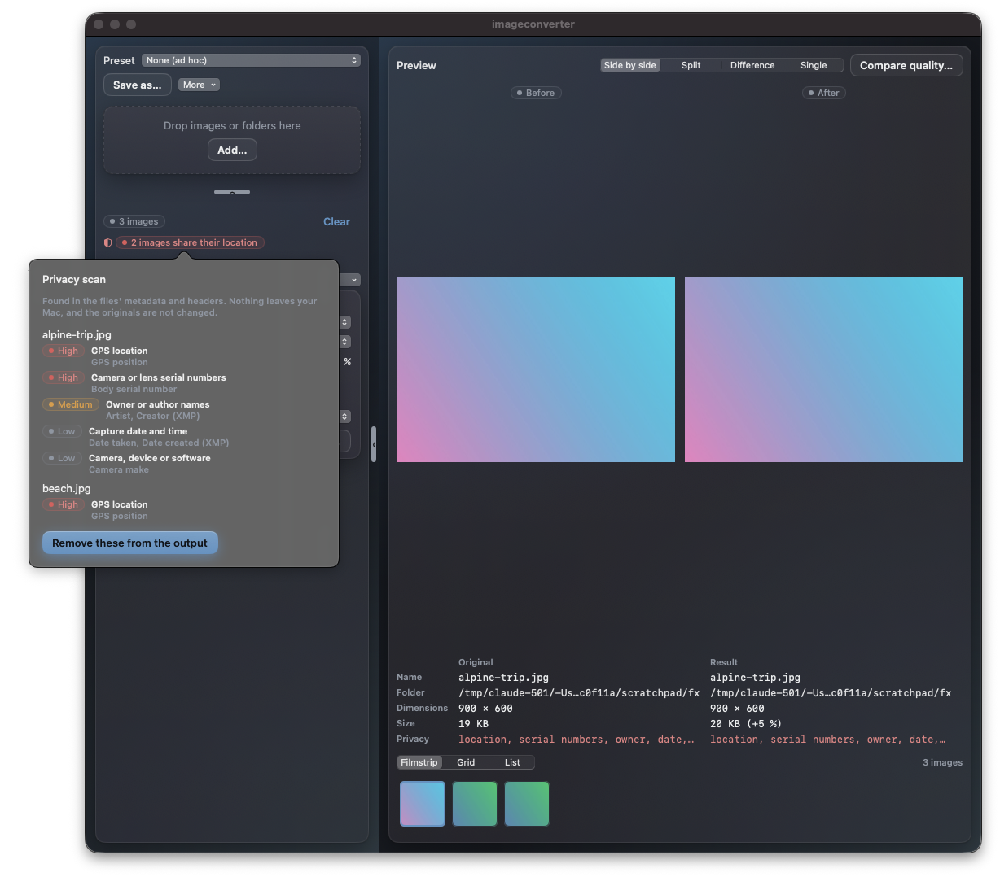
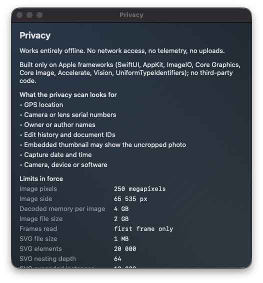
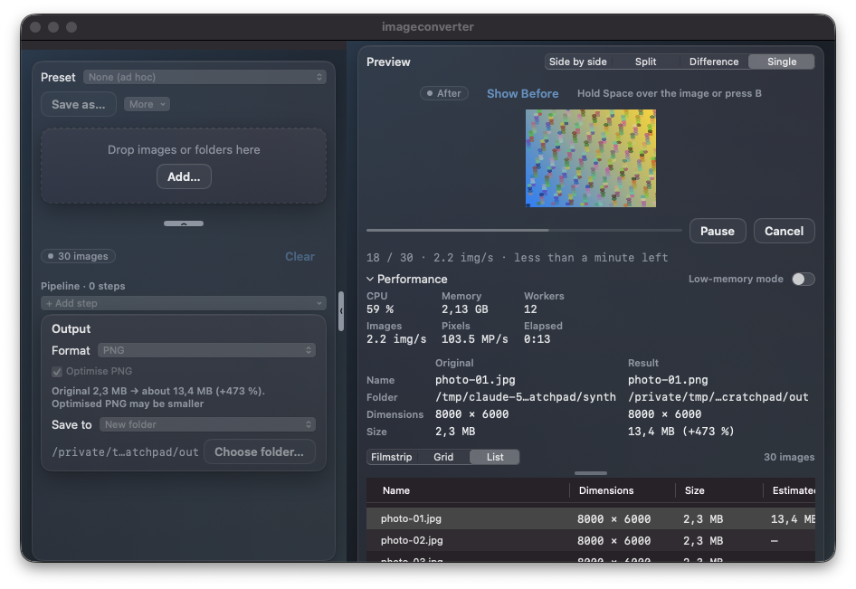
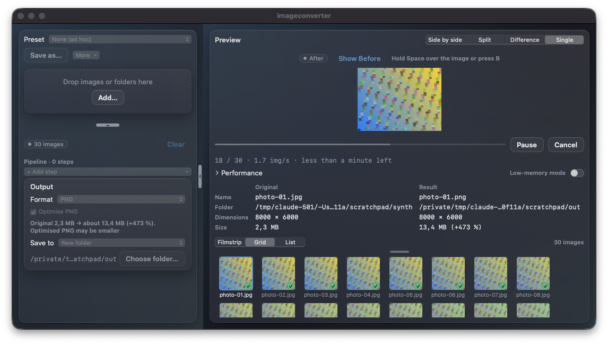
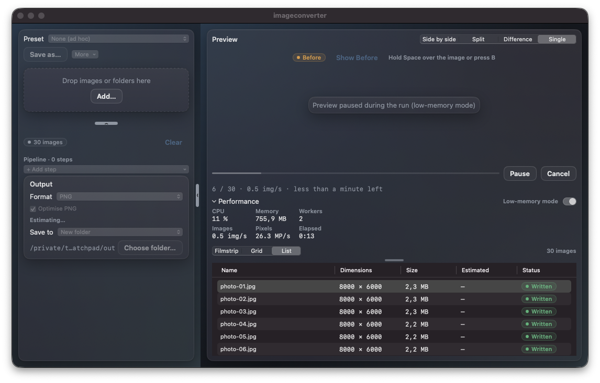
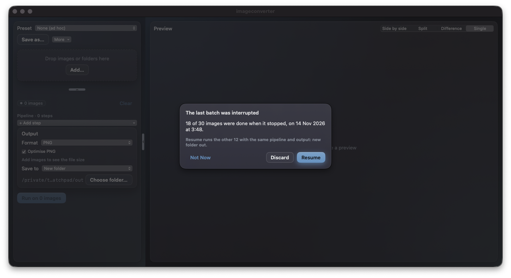

# imageconverter

A native macOS app for **batch image processing**. Drop in a pile of images or folders, build a
pipeline once (resize, crop, watermark, clean metadata, rename, convert) and run it over all of
them. It reads every image format your Mac can decode and writes the common ones. Everything happens
on your Mac: no uploads, no network access at all.

For anyone who regularly prepares photos for the web, for sharing or for archiving, and is tired
of doing it one image or one operation at a time.

**Version:** 0.1.0 · **Status:** early development (milestone 1, batch conversion, works; the image steps resize, crop, rotate/flip, canvas and color profile, plus metadata and rename, are available; the adjust and watermark steps are available; presets and the before/after preview are available).
Started 2026-11-13. The full design is in
[docs/superpowers/specs/2026-11-13-imageconverter-design.md](docs/superpowers/specs/2026-11-13-imageconverter-design.md).

## Privacy

- **Works entirely offline.** No network access, no telemetry, no uploads. The app has no network entitlement, and a test fails the build if networking APIs appear in the sources.
- **Built only on Apple frameworks** (SwiftUI, AppKit, Foundation, Observation, Charts, ImageIO, Core Graphics, Core Image, Core Text, Core Services, Metal, Accelerate, Vision, UniformTypeIdentifiers, UserNotifications); no third-party code.
- **Your files are untrusted input.** Images, SVG watermarks, preset and template files, `imageconverter://` links and AppleScript requests are all validated before use. Limits in force: images up to 250 megapixels, 65,535 px on a side, min(4 GB, a quarter of the Mac's memory) of decoded memory and 2 GB per file (first frame only); SVG files up to 1 MB, 20,000 elements, 64 levels deep; preset and template files up to 1 MB; links up to 16,384 characters. Help ▸ Privacy… shows these as built. See [SECURITY.md](SECURITY.md).
- **Privacy scan.** When you add images, the app reads each file's header and metadata (never the pixels) and looks for: GPS location (high), camera and lens serial numbers (high), an embedded thumbnail whose shape differs from the image, which may show the uncropped photo (high), owner or author names (medium), edit history and document IDs (medium), capture dates (low) and camera, device or software (low). A shield chip under the image count says what was found ("2 images share their location"); click it for a list per image and **Remove these from the output**, which turns on the Metadata step with the matching removals (anything you already remove stays removed). The Metadata step's removals are a floor: images an **If … then … else** step sends to its own **Set metadata…** or to **Copy original unchanged** lose them too. The preview table's **Privacy** row shows what the original has and what the result would still carry, scanned from the output the app would write. Originals are never changed.
- **Temporary files are deleted, not wiped.** Output is written to a hidden temporary file next to its destination and moved into place; on cancel, quit or a failed write the app deletes these files. On SSDs and APFS, deleting (or overwriting) a file does not reliably erase its old blocks, so the app does not claim to securely wipe anything.

<table>
  <tr>
    <td><br>The shield chip's panel: findings per image, with severity</td>
    <td><br>Help ▸ Privacy…: the statement and the limits in force</td>
  </tr>
</table>

## What's new

### Unreleased

- **Overwrite with rename**: *Overwrite original files* now works with the Rename step. The renamed result is saved next to the original, which then goes to the Trash; an unchanged name and format still replaces the file in place.
- **Hover help**: rest the pointer on a step's title (or Output) for 1.5 s to see what it does and how to use it.
- **Many more conditions**: If … then … else can now check the file name, extension and folder, the date taken, created or modified, any metadata field (lens, ISO, copyright, keywords, …), megapixels, aspect ratio, bit depth, color space and profile, DPI, EXIF rotation and animation, each with **Not**; and its branches can save into a subfolder, add Finder tags or keywords, apply a saved preset, stop checking later conditions or add a note to the report. See [Process images differently](#process-images-differently-by-size-format-or-orientation).
- **App bundle and release script:** `scripts/release.sh` builds a universal, sandboxed `imageconverter.app` with the command-line tool inside (`Contents/Helpers/imageconverter`), and `scripts/install-cli.sh` puts that tool on your PATH. See [Build the app bundle](#build-the-app-bundle).
- **Folder access** for the sandboxed app: a run that needs a folder asks for it once with a pre-filled panel, and the answer is remembered (Help ▸ Folder Access… lists and removes them); the output folder, watermark images and an interrupted batch keep bookmarks so they still open after a relaunch. See [Folder access](#folder-access).
- **Privacy**: an automatic privacy scan with a shield chip and panel ("Remove these from the output"), a Privacy row in the preview table, and Help ▸ Privacy… with the offline statement and the limits in force. See [Privacy](#privacy).
- **Jobs** (Window ▸ Jobs, ⌘J): watch folders or run on a schedule with a saved pipeline or a linked preset, while the app is open; one run at a time per job, a catch-up run when watching starts, a report file per run, notifications, and an optional menu bar mode. See [Process a folder automatically](#process-a-folder-automatically).
- **Reports and history**: after a run the Report section shows summary cards with Export (CSV, JSON, HTML, text) and the error log, and Window ▸ History (⌥⌘H) keeps the last 100 runs, manual and jobs. See [Reports and history](#reports-and-history).
- **Performance**: Pause/Resume (⌥⌘.), "12 / 124 · 3.4 img/s · about 2 min left", each image's stage in the list and as a ring on the thumbnails, a Performance panel (CPU, memory, workers, img/s, MP/s, elapsed), Low-memory mode, Process Next, a preview that keeps working during a run, and an offer to resume a batch that was interrupted. See [Performance](#performance).
- Finder Quick Actions ("Convert with imageconverter" and up to 5 pinned presets), AppleScript commands (`convert`, `add files`, `run batch`, `presets`) and `imageconverter://` links, active once the app is packaged (milestone 6). See [Finder, AppleScript and links](#finder-applescript-and-links).
- Watermark editor: rotation (with 0°/−45°/45°/90° buttons), a Tiled layout (spacing, staggered rows), shadow and outline for text, an **Insert** menu for tokens such as `{filename}` and `{year}` with the text shown for the selected image, SVG logos (including Illustrator exports), and a **Templates** menu (Apply, Save as template…, Delete).
- If / then / else steps: test each image's size, file size, format, transparency, orientation, GPS or camera, and give it its own steps, output, metadata or rename, copy it unchanged or skip it; the preview shows which branch an image takes, and skipped files are counted apart from failures.
- Geometry editors: free angle and straighten, Perspective (Auto and keystone), Trim and the canvas Ratio mode.
- Compression modes in the Output row: Quality, Target size, Maximum size and Smart, Progressive JPEG, Optimise PNG and AVIF; the estimate shows the chosen quality.
- Compression report: size percentages in the estimate and preview, a "saved" toast after a run, and a Report section in the sidebar (per-file sizes, skipped files, notes).
- **Save to** dropdown in the Output row (new folder, same folder, overwrite originals) replaces the Settings window, and the same-folder suffix defaults to `_new`.
- Adjust step: exposure, brilliance, highlights, shadows, contrast, brightness, black point, saturation, vibrance, warmth, tint, hue, sharpness, definition and noise reduction.
- Find and replace (plain text or regular expression) in the Rename step.
- Size estimate ("Original → about") under the quality slider.
- Grab handles on the panel edges and View > Hide Preview (⌥⌘P) / Collapse Pipeline (⌥⌘L); the window resizes with them.
- Original | Result table under the preview (name, folder, dimensions, size); progress bar and Cancel above it during a run.
- Drop images or folders anywhere in the window (not only on the drop zone); the window highlights while you drag.
- Pipeline rows reorder with a drag handle (Move Up/Down in the context menu).
- Zoom the before/after preview with a trackpad pinch (or ⌘+ / ⌘− / ⌘0); both sides stay in sync, so encoder artifacts are easy to compare.
- Compare modes (View ⌘1…⌘4): Side by side, Split with a draggable divider, Difference (amplified, with PSNR and mean error) and Single (hold Space or press B for Before); a checkerboard shows transparency; "Compare quality…" encodes the image at 40/60/80/95 % to pick a quality; the batch shows as a filmstrip, grid or list (with each file's result after a run).
- Presets (save, save as, rename, delete, reset; three built-ins) and a collapsible before/after preview with a filmstrip of the batch.
- Watermark step: text (font, colour, shadow, outline, tokens such as `{filename}` or `{year}` filled in per image) or an image (e.g. a PNG or SVG logo, optional shadow), placed once at one of nine positions or tiled over the whole image, with size relative to the image, opacity, margin, rotation and reusable templates.
- Metadata step (remove location, camera details or everything; set artist, copyright and description) and Rename step with tokens ({date}, {camera}, {counter:000}, …) and a live example.
- Wide-colour (Display P3) photos keep their colour when resized and saved as JPEG; opaque images stay opaque through steps; memory use accounts for enlargement.
- Pipeline steps: resize, crop, rotate/flip, canvas/padding and color profile; steps can be reordered, switched off and removed; the pipeline is kept between launches. Large images are scheduled by memory use; file types macOS can't read (e.g. SVG) are ignored when adding folders.

### 0.1.0

- Project created. Older versions are listed in [CHANGELOG.md](CHANGELOG.md).

## Features

- **Reads** every format macOS can decode: HEIC, JPEG, PNG, TIFF, GIF, BMP, WebP, AVIF, PSD, camera
  RAW, JPEG 2000, ICNS and more. Animated and multi-page files are read using their first frame.
- **Writes** JPEG, PNG, HEIC and TIFF, plus GIF, BMP and JPEG 2000 where macOS supports them, with
  quality and compression options.
- **Pipeline** of steps, applied in order to every image. Steps can be switched off and reordered:
  - (available) **Resize**: a grouped mode picker. *Pixels*: max width, max height, fit inside a box,
    exact size (stretch, fit and pad, or fill and crop), longest edge, shortest edge, minimum size.
    *Scale*: percentage (1 to 1000). *Print*: physical size in cm or inches at a DPI (leave one side empty
    to follow the aspect ratio; with both set the image fits inside). Every mode keeps the aspect ratio
    except Stretch. "Don't enlarge" is on by default and is hidden for the modes where it makes no sense
    (percentage, physical size, print sheet, minimum size, stretch). A **Presets** menu fills the editor, grouped:
    *Print* (Photo in cm: 9 × 13 to 50 × 70; Photo in inches: 4 × 6 to 16 × 20; Paper: A6 to A2, Letter, Legal,
    Tabloid; all at 300 dpi as a **Print sheet**, which fits the image inside the sheet turned the way round
    its own orientation needs, so a landscape photo into 10 × 15 cm gets 15 × 10 cm), *Web* (Thumbnail 150 px
    to Extra large 2560 px and Email 1024/1600, longest edge, don't enlarge), *Devices & wallpapers*
    (iPhone, iPad, MacBook screens, Full HD, 4K, 5K, ultrawide), *App & web assets* (avatar, profile, favicons,
    Open Graph, blog header), *Social media* sizes (exact size, fill and crop, enlarging) and *Resolutions*
    such as 1080p and 4K (fit inside, don't enlarge). Applying a preset never changes the resampling or the DPI
    setting. Pick the **resampling** (Lanczos, Bicubic, Bilinear, Nearest neighbour). **Set DPI** (default
    300) labels the output's print resolution without changing pixels.
  - (available) **Crop**: fixed size or aspect ratio (a menu of common ratios or a custom one), with an anchor point
  - (available) **Rotate / flip**: 90° turns, an **Angle** (slider −45…45°, or type −180…180°, clockwise) with
    **Fill corners** (white, transparent or a colour; the canvas grows) or **Crop to fit (straighten)** (the
    largest centred rectangle with the original ratio), **Mirror (flip horizontally)** and **Flip vertically**
  - (available) **Perspective**: **Auto** finds a document or screen and squares it up (the report says "No
    document edges found" if there is none); **Vertical** and **Horizontal** keystone sliders (−100…100) are
    applied after it, with the result cropped so no empty corners show
  - (available) **Trim**: removes a border of transparent pixels, one **Colour**, or the **Edge colour**
    (the colour of the top-left pixel); **Tolerance** 0–100 % and **Padding** in pixels keep a margin
  - (available) **Canvas / padding**: padding in pixels or percent, a fixed canvas size, or a **Ratio** (1:1 … 3:4 or
    custom) that grows the shorter side without cropping, with an anchor and a background colour
  - (available) **Color profile**: convert to sRGB, Display P3 or Gray, or keep the original
  - (available) **Adjust**: exposure, brilliance, highlights, shadows, contrast, brightness, black point,
    saturation, vibrance, warmth, tint, hue, sharpness, definition and noise reduction
  - (available) **Watermark**: text (with tokens, shadow and outline) or image (raster or SVG), single or tiled,
    with position, size, opacity, margin and rotation controls, and watermark templates
  - (available) **Condition** (if / then / else): up to 10 checks, all or any of which must hold, each of
    which can be turned around with **Not** ("is not", "does not contain", "has no"). Name & location: file
    name contains / starts with / ends with / is / matches a pattern (optionally matching case), extension,
    folder path. Dates: date taken (EXIF, else XMP), file created, file modified: before, after, between,
    within the last N days, in a year or month, or present at all. Metadata: camera make and model, lens, ISO,
    focal length, aperture, shutter speed, artist, copyright, title, description, keywords, software and any
    allowlisted EXIF/IPTC/XMP field (is, contains, is present, is missing; numbers also more than / less than /
    at least / at most). Image: longest edge, width, height, megapixels, aspect ratio, orientation, file size,
    format (a writable format or any file type, e.g. camera RAW), transparency (checked on a small
    thumbnail), bit depth, color space, embedded color profile, DPI, rotated by EXIF orientation, animated or
    multi-page, location, camera. Each branch (up to 20 actions) can add image steps (not another condition)
    or **apply a saved preset**'s steps and settings, change the output format and settings, metadata or rename
    for that image, **save into a subfolder** (rename tokens, e.g. `{date:yyyy}/{date:MM}`), add **Finder
    tags**, add **keywords**, **copy the original** unchanged (same bytes and extension, nothing decoded; in
    overwrite mode the file is left as it is), **skip** it (nothing written; reported as "Skipped by a
    condition", not as a failure, and not given a counter number), **stop** checking later conditions, or add
    a **note** to the report. Conditions are tested against the **source file** (its header), not against the
    image part-way through the pipeline, so a resize before a condition doesn't change what it sees. With
    several conditions, later overrides win and skip wins over copy. The preview and size estimate follow
    each image's own branch.
  - (available) **Metadata** (always last, above Output): strip everything (with a keep list) or single
    groups, set title, artist, copyright, description, keywords, date taken, GPS and allowlisted extra fields,
    with templates; the color profile is always kept
  - (available) **Rename** (always last): a pattern such as `{date:yyyy-MM-dd}_{camera}_{counter:000}`,
    with a live example
- **Presets**: save a pipeline under a name (Save, Save as, rename, delete, reset to the saved version, and **More ▸ Clear All…** to empty the image list and start again from an empty pipeline), start from three built-ins, or set up a one-off run without saving. A preset holds the steps, output format and quality, metadata and rename; the output mode stays a global setting.
- **Live preview** of the selected image before and after the pipeline, with its new name and
  size, an Original | Result table (name, folder, dimensions, file size with a live estimate), and the batch as a filmstrip, grid or list; pinch to zoom in sync in every comparison mode (side by side, split, difference, single), with a checkerboard behind transparent images and a quality ladder to choose the output quality. Renders happen in the background 300 ms after an edit. The preview (⌥⌘P) and the pipeline can both be collapsed for a compact window; the choice is remembered.
- **Safe runs**: progress with cancel, unreadable files skipped and listed at the end, no
  half-written files, and name collisions resolved with `_2`, `_3`, …

## Screenshots

<!-- Once the UI exists, show the screenshots in a grid with a caption under each (claude-shots
     --write imageconverter refreshes the images), e.g.:
<table>
  <tr>
    <td><br>The main window with preview</td>
    <td><br>Compact mode during a run</td>
  </tr>
</table>
-->

## Installation

Requires macOS 14 (Sonoma) or later.

- **Download** (from 1.0): a signed and notarized `imageconverter.app`. Move it to Applications
  and open it.
- **From source:**

  ```sh
  swift run           # opens the app window (or: claude-update)
  swift build
  ```

- **App bundle from source:** `scripts/release.sh` builds `dist/imageconverter.app` (ad hoc signed, so it
  runs on the Mac that built it); copy it to Applications. See [Build the app bundle](#build-the-app-bundle).
  An ad hoc build copied to another Mac (or downloaded) is blocked by Gatekeeper ("can't be opened" /
  "unidentified developer"): right-click the app › **Open** and confirm once, or remove the quarantine flag
  with `xattr -dr com.apple.quarantine /Applications/imageconverter.app`. A notarized build needs neither.
- **Command-line tool:** the app carries it at `imageconverter.app/Contents/Helpers/imageconverter`.
  `scripts/install-cli.sh` links it as `~/.local/bin/imageconverter` (no sudo; pass the app's path if it
  isn't in `/Applications`) and tells you if that folder isn't on your PATH.

### Build the app bundle

```sh
scripts/release.sh                 # ad hoc signed: dist/imageconverter.app + dist/imageconverter-<version>-unsigned-adhoc.zip
SIGN_IDENTITY="Developer ID Application: …" NOTARY_PROFILE=<profile> scripts/release.sh --notarize
```

The script reads the version from `VERSION` (must be `x.y.z`, three numbers without a suffix), builds a
universal (arm64 + x86_64) release (falling back to this Mac's architecture, with a warning, only when the
toolchain can't build a second architecture, i.e. Command Line Tools without Xcode; any other build error
stops the script), and assembles the bundle in a temporary folder:
the app, `AppIcon.icns` (from `Resources/AppIcon.png`), the AppleScript dictionary, and an `Info.plist` made
from `scripts/Info.plist.template` plus `Resources/Info-fragments.plist` (Services, AppleScript, `imageconverter://`
links), with `CFBundleShortVersionString` = `VERSION`, `CFBundleVersion` = the number of commits and the
copyright year from the last commit (holder from `LICENSE`). Only a signed and verified bundle is moved into
`dist/`, replacing the previous app and any older zips there; a failed run leaves `dist/` as it was.

| Setting | Default | Meaning |
| --- | --- | --- |
| `SIGN_IDENTITY` | `-` (ad hoc) | The codesign identity. Ad hoc builds run only on this Mac without a Gatekeeper warning. |
| `NOTARY_PROFILE` | none | A `notarytool` keychain profile (`xcrun notarytool store-credentials`); required by `--notarize`. |
| `--notarize` | off | Submit to Apple's notary service, wait, staple, and write `dist/imageconverter-<version>.zip`. Refused with an ad hoc identity or without `NOTARY_PROFILE`. When the submission isn't `Accepted`, prints the notary log and fails. |

Both executables get the hardened runtime. The app is signed with `Resources/imageconverter.entitlements`:
App Sandbox, user-selected read/write files and app-scoped bookmarks, no network. The script checks the
signature (`codesign --verify --strict --deep`), that the sandbox entitlement is there and that no network
entitlement is. The command-line helper is signed **without** the sandbox: you run it from Terminal with your
own permissions on whatever paths you name. A real identity without `--notarize` gives
`…-not-notarized.zip`. Every zip gets a `.sha256` file next to it. Credentials stay in the keychain.

## Configuration

The output settings are in the Output row of the sidebar (there is no Settings window). The pipeline itself (steps and output format) is edited in the sidebar and saved automatically (UserDefaults key `currentPipeline`); if it cannot be read at launch you start with an empty pipeline and the default output.

| Setting | Options | Default |
|---------|---------|---------|
| Save to | New folder · Same folder as original · Overwrite original files (the "Save to" dropdown in the Output row). Overwrite replaces each original; with a new name (Rename step) or format the result is saved next to it and the original goes to the Trash after the new file is saved | New folder |
| Output folder | Any folder (used by "New folder") | asked on first run |
| Same-folder suffix | Added by "Same folder" only when the output would have the same name as the original | `_new` |

Metadata and Rename (pipeline steps, saved with the pipeline; "Always last"):

| Option | What it does | Default |
|--------|--------------|---------|
| Metadata | Switches the Metadata step on | off |
| Remove all metadata | Strips all metadata except the **Keep** list (copyright, author, date taken, camera details, location; orientation and the color profile are always kept) | off |
| Remove location / camera / author / thumbnail / IPTC / XMP | Individual removals (see "Metadata step" below) | location on, others off |
| Set title / artist / copyright / description | Writes the text after the removal (an empty text removes the field; the © button inserts the sign) | off |
| Keywords | Tokens added to, or replacing, the file's keywords | none |
| Date taken | Keep, Set (date and time) or Shift (earlier/later by days, hours, minutes). A saved setting that can't be read (a hand-edited preset) falls back to Keep, and the editor and the batch report say "Saved date setting was invalid and was ignored" | Keep |
| Set file dates to date taken | The output file's creation and modification dates follow the date taken | off |
| Location | Keep, Remove, or Set latitude, longitude and optional altitude | Keep |
| More fields | Extra EXIF/IPTC/XMP fields from the allowlist | none |
| Rename | Switches the Rename step on | off |
| Pattern | Rename pattern, see the token table below | `{name}` |
| Find / Replace | Replaces text in the name after the pattern; plain text or a regular expression | empty |
| Prefix / Suffix | Text added before and after the finished name (after find and replace) | empty |
| Remove spaces | Deletes all spaces from the name | off |
| Special characters | Keep, Replace (each run of other characters becomes one `-`, `_`, `.` or nothing; runs at the ends are trimmed) or Remove everything except letters (any language), digits, `-`, `_` and `.` | Keep |
| Case | Keep, lowercase, UPPERCASE, camelCase, PascalCase, snake_case, kebab-case or Title Case | Keep |
| Counter starts at | First `{counter}` value, 0 to 999 999 999 | 1 |

While the Metadata step is on, the file's XMP (Lightroom/Photoshop fields such as usage terms) is carried over
too, cleaned with the same rules: removing everything, the location, camera details, the author or IPTC also
removes those fields from the XMP. With the step off, only EXIF, IPTC and GPS are copied, as before.

Adjust (pipeline step, saved with the pipeline). Every slider defaults to 0 (no change); the step is applied in
this fixed order whatever order the sliders are moved in:

| Option | What it does | Range |
|--------|--------------|-------|
| Exposure | Brightens or darkens the whole image (±2 stops) | −100 to +100 |
| Highlights | Negative recovers bright areas, positive lifts them | −100 to +100 |
| Shadows | Positive opens up dark areas, negative deepens them | −100 to +100 |
| Brilliance | Positive lifts shadows and softens highlights, negative does the opposite | −100 to +100 |
| Black point | Positive deepens the blacks, negative lifts them to grey | −100 to +100 |
| Contrast | Lower or higher contrast | −100 to +100 |
| Brightness | Shifts all tones darker or lighter | −100 to +100 |
| Saturation | −100 is black and white, +100 doubles the colour | −100 to +100 |
| Vibrance | Like saturation, but mostly affects muted colours | −100 to +100 |
| Warmth | Positive is warmer (more yellow), negative cooler (more blue) | −100 to +100 |
| Tint | Positive is more magenta, negative more green | −100 to +100 |
| Hue | Rotates every colour around the colour wheel | −180° to +180° |
| Noise reduction | Smooths fine grain | 0 to 100 |
| Definition | Local contrast (a wide, gentle unsharp mask) | 0 to 100 |
| Sharpness | Sharpens fine detail | 0 to 100 |

Watermark (pipeline step, saved with the pipeline):

| Option | What it does | Default |
|--------|--------------|---------|
| Content | Text or Image | Text (a new step starts with `© ` and your full name) |
| Templates | Apply a built-in or saved watermark, save the current one as a template, delete a saved one | – |
| Text | The text to draw, on one line; may contain tokens (see below). Control and invisible characters are removed and it is cut to 200 characters | `©` |
| Insert | Adds a token at the end of the text; the line under the field shows the text for the selected image | – |
| Font | Helvetica Bold, Helvetica, Avenir Next Demi Bold, Georgia Bold, Menlo Bold or System bold | Helvetica-Bold |
| Color | Text colour (with transparency) | white |
| Shadow | Text or image: a drop shadow down and to the right, with colour, Blur (0 to 50 %) and Offset (0 to 50 %), both relative to the mark's height | off (when on: black at 60 %, blur 10 %, offset 6 %) |
| Outline | Text only: a stroke around the letters, under the fill, with colour and Width (0 to 20 % of the line height) | off (when on: black, 6 %) |
| Image | A logo or picture: any format the app reads (PNG, JPEG, HEIC, TIFF, …) or SVG (see below) | none |
| Layout | Single (one mark at the position) or Tiled (repeated over the whole image) | Single |
| Spacing | Tiled only: gap between marks, percent of the (rotated) mark's size (0 to 400 %) | 100 % |
| Stagger rows | Tiled only: every other row is shifted by half a step | on |
| Position | One of nine anchor points (not used when tiled) | bottom right |
| Size | Percent of the shorter side of the photo (1 to 100 %) | 4 % for text, 20 % for an image |
| Opacity | 0 to 100 % | 65 % |
| Margin | Distance from the edges, percent of the shorter side (0 to 25 %); not used when tiled | 3 % |
| Rotation | −180° to 180°, clockwise, about the mark's centre (buttons for 0°, −45°, 45° and 90°) | 0° |

Built-in watermark templates: **© corner** (`© {year} {artist}`, bottom right, 4 %), **Tiled diagonal**
(`© {artist}`, tiled at −30°, 15 % opacity) and **Filename + date** (`{filename} · {date}` with a shadow, bottom
left). Saved templates are JSON files in `~/Library/Application Support/imageconverter/watermark-templates/`;
an image template stores the image's path.

Watermark text tokens (unknown tokens are drawn as typed):

| Token | Becomes |
|-------|---------|
| `{filename}` | The original's name without its extension |
| `{filename.ext}` | The original's name with its extension |
| `{date}` | The date taken (from the photo's EXIF, else the file's creation date) as `2026-11-14`; a Set or Shift in the Metadata step is what it shows, and it is empty when the Metadata step removes everything without keeping the date |
| `{date:FORMAT}` | The same date in your own format, e.g. `{date:d MMM yyyy}` (Unicode date patterns) |
| `{year}` | The year of that date |
| `{copyright}` | The copyright: from the Metadata step when it sets one, else the file's own; empty when the Metadata step removes it |
| `{artist}` | The author, the same way (empty when the Metadata step removes the author) |

SVG watermarks: an SVG logo is checked and rewritten before it is drawn, and nothing is ever downloaded.
It can be at most 1 MB and must be plain SVG in UTF-8: shapes, paths, gradients, clip paths, masks, patterns and
text, linked only to parts of the same file. The standard SVG doctype and simple style sheets (as Adobe Illustrator
exports them: rules like `.st0{fill:#E30613;}` for classes, ids or element names, setting colours, strokes, fonts
and opacity, including `rgb()` and `hsl()` colours) are accepted, up to 2 000 selectors. Style rules are applied in a
simplified way: a later rule wins over an earlier one whatever its selector, and a colour or other setting written
directly on a shape wins over the style sheet (browsers let the style sheet win), so a file that mixes both can look
different here. Anything else is refused with the reason, shown
under **Choose image…** and for each file in the batch:
- "This SVG uses embedded images or links to other files, which aren't allowed." (embedded pictures, `data:` URLs,
  links to other files or websites, `@import`)
- "This SVG uses features that aren't supported (scripts, animation or advanced styling)." (scripts, animation,
  entities, CSS beyond simple rules, references that loop or expand to more than 10 000 shapes)
- "This SVG is too large (over 1 MB)." and "This file isn't a valid SVG."

When an SVG is refused, export the logo again as plain SVG (or as a PNG with a transparent background).

Jobs (Window ▸ Jobs, ⌘J; see [Process a folder automatically](#process-a-folder-automatically)):

| Setting | What it is | Default |
|---------|------------|---------|
| Jobs folder | `~/Library/Application Support/imageconverter/jobs/`, one `<UUID>.json` per job plus `<UUID>.ledger.json` (the files it processed) | created on first save |
| Pipeline | The job's own copy, or a preset whose current pipeline is used at run time | copy of the main window's pipeline (a link when an unmodified preset is selected) |
| Input folders | Up to 64 folders; **Include subfolders** watches inside them too | none, subfolders off |
| Save to | Same choices as the Output row (new folder, same folder with a suffix, overwrite) | the main window's Save to |
| Start | Manually · When files arrive (watch) · On a schedule every N minutes or hours (5 min … 30 days) | When files arrive |
| Report | None · CSV · JSON · Text · HTML, written next to the outputs after each run that processed files | CSV |
| Enabled | Off: never starts by itself (Run Now still works) | on |
| Pause all jobs | Bottom of the Jobs window or the menu bar; UserDefaults key `jobsPaused` | off |
| Keep running in the menu bar when the window is closed | Shows the menu bar item and hides the Dock icon once the last window closes; key `keepInMenuBar` | off |

Performance:

| Setting | What it is | Default |
|---------|------------|---------|
| Low-memory mode | At most two images at a time and a quarter of the memory budget; the preview pauses during a run. View ▸ Low-Memory Mode or the switch in the Performance panel; takes effect from the next image of a running batch. UserDefaults key `lowMemoryMode` | off |
| Performance panel | Shown or hidden with its disclosure arrow (not saved) | hidden |
| Run journal | `~/Library/Application Support/imageconverter/journal.json` while a batch runs; deleted when it finishes or is cancelled | — |

Presets and preview:

| Setting | What it is | Default |
|---------|------------|---------|
| Presets folder | `~/Library/Application Support/imageconverter/presets/`, one `<UUID>.json` file per preset | created on first save |
| Web export (built-in) | Resize fit 2048 × 2048, color sRGB, metadata strip location, JPEG 82 % | n/a |
| Instagram 4:5 (built-in) | Resize exact 1080 × 1350 fill & crop, sRGB, metadata strip location, JPEG 85 % | n/a |
| Archive TIFF (built-in) | No image steps, metadata off, TIFF LZW | n/a |
| Show preview | View → Hide Preview / Show Preview (⌥⌘P); UserDefaults key `previewCollapsed` | shown |
| Pipeline collapsed | The handle on the pipeline's edge or View → Collapse Pipeline (⌥⌘L); key `pipelineCollapsed` | expanded |
| Compare mode | The Compare control in the preview header or View → Side by side / Split / Difference / Single (⌘1…⌘4); key `compareMode` | Side by side |
| Split position | Where the split divider sits (2…98 % of the width); key `compareSplitPosition` | 50 % |
| Batch view | Filmstrip, Grid or List under the preview; key `batchBrowserMode` | Filmstrip |
| Grid / list height | Drag the bar above the grid or list (90…420 pt); key `batchBrowserHeight` | 180 pt |

In *Overwrite originals* mode, a rename that only changes letter case keeps the original name.

CMYK and indexed-colour sources are converted to sRGB by pixel steps (colour-managed, so they
look the same). Gray images stay gray (with or without transparency), and wide-colour (Display P3)
images keep their colour space.

Choosing **Overwrite originals** shows a warning once, when you select it, and never during runs.
In this mode, when the format or name changes (for example HEIC → JPEG, or a Rename pattern), the new
file is written into the original's folder and only then is the original **moved to the Trash**. No other
file is ever replaced: a new name that is taken by another file, by another image of the batch or by
another image's new name gets `_2`, `_3`, … In "New folder" mode, dropped folders keep their
subfolder structure.

The packaged app (built by `scripts/release.sh`) runs in the App Sandbox, so it can only touch files
and folders you drop or pick. When you drop loose files and write next to them, it asks once per
folder for access and remembers your answer (see [Folder access](#folder-access)). `swift run` runs
unsandboxed.

## How to

### Save a preset

1. Build the pipeline, then press **⌘S** (or Save in the preset bar). On a built-in or a one-off
   pipeline this opens "Save as": type a name (1 to 80 characters, unique) and confirm.
2. Pick a preset in the preset bar to load it. If you have unsaved changes, you are asked
   "Discard changes to <name>?" first. Reset returns to the saved version; rename and delete are in
   the preset bar. Built-ins can't be changed or deleted.

### Preview before running

1. Add images; the preview pane on the right shows the first one before and after the pipeline,
   with an Original | Result table underneath (name, folder, `W × H`, file size; the result size is estimated and shows "Estimating…" while it is computed).
2. Click a thumbnail in the filmstrip, or focus it and press ← / →, to look at another image. The
   picker above it switches to a **Grid** (← → ↑ ↓ move the selection; drag the bar on top, or focus it
   and press ↑ / ↓, to make the area taller or lower) or a **List** with each file's name, dimensions,
   file size, the estimated output size (for the selected image, once it is known) and, after a run,
   whether it was written, skipped or failed.
3. Edit a step: the preview updates 300 ms later, and shows a spinner meanwhile. If an image can't
   be rendered, the reason is shown instead of the "after" image. The preview shows the name for
   that image alone; numbers like `_2` that avoid clashes within a batch appear only when you run it.
4. Hide the preview with the handle on its edge or ⌥⌘P (View menu); the window shrinks to the sidebar. While a batch runs, the progress bar and Cancel sit above the table.
5. Zoom in to compare quality: pinch on either image (both zoom around the pinch point and always
   show the same region), pan with two fingers or by dragging, double-click to switch between fit and
   100 % (one image pixel per screen pixel) at that point. View › Zoom In (⌘+ or ⌘=), Zoom Out (⌘−),
   Zoom to Fit (⌘0) and Actual Size (⌥⌘0) do the same from the keyboard. Zoom goes up to 800 %; the
   level shows next to the "Preview" title. Once the size estimate is ready, the zoomed view shows the
   full-size original and the really encoded result (above 100 % without smoothing), so JPEG blocks
   and other artifacts are visible. Selecting another image resets to fit; changing settings keeps
   the zoomed region. Both sides show the same region when the pipeline has no Crop, Rotate / flip
   or Canvas step (resize and format changes are fine); with those steps the two sides are zoomed to
   the same relative position, which is not yet the same part of the photo.
6. Choose how to compare with the **Compare** control in the preview header (or View ⌘1…⌘4):
   - **Side by side**: Before and After next to each other (stacked when the pane is under 560 pt wide).
   - **Split**: one image, Before left of a divider and After right of it. Drag the divider (or focus
     the image and press ← / →); its position is remembered. Zoom and pan work as usual.
   - **Difference**: the difference between the original and the really encoded result, amplified
     four times on black, with PSNR, mean and maximum error underneath. At fit it is computed on the
     whole image scaled down to at most 2048 px ("scaled down"); zoomed in, on the visible region only
     ("visible region"), at full resolution up to that size, again after each pan or zoom. It needs the
     size estimate and the same pixel size on both sides; otherwise it says "Not available: the size changes".
   - **Single**: After as large as possible. Hold Space **with the pointer over the image** (elsewhere
     Space keeps pressing the focused button), press B (not while typing or in the list), or click
     **Show Before** to see the original; the label says which one is shown.
   Transparent areas show a light or dark checkerboard (8 pt squares) in every mode and in the
   thumbnails.
7. For JPEG, HEIC, JPEG 2000 and AVIF, **Compare quality…** opens four tiles with the selected image
   encoded at 40, 60, 80 and 95 %, each with its file size and the change from the original. They
   show the region the preview shows (cropped again after a pan or zoom, without encoding again; only
   that crop and the encoded files are kept). Images over 100 megapixels show "Too large to compare
   here". Click a tile to use that quality (Target size and
   Smart switch to Quality; Maximum size keeps its limit). The tiles are rendered in the background
   and start again when you select another image or change the pipeline.

### Build a pipeline

1. In the sidebar, press **+ Add step** and pick Resize, Crop, Rotate / flip, Perspective, Trim, Canvas / padding,
   Color profile, Adjust, Watermark or **If … then … else** (see below). The step is added at the end and opens so you can set it.
2. Open or close a step by clicking its row; its settings (size, anchor, colour, profile, ...) are
   inside. The muted line under the name summarises them. The header shows how many steps are on.
3. Reorder by dragging the handle, or with the keyboard: the right-click menu has
   **Move Up**, **Move Down** and **Remove**.
4. Switch a step off with its toggle to skip it without losing its settings; it is dimmed.
5. Steps run top to bottom on every image. The **Output** row is always last: format, quality and
   where files go. The handle on the pipeline's bottom edge (or ⌥⌘L) hides the whole list.

Your pipeline is kept between launches.

### Convert a batch

1. Drop images or folders onto the window, or press **Add…** (⌘O). Folders are searched
   recursively. File types macOS can't read (for example SVG or PDF) are ignored when you add
   them; broken files of a readable type are skipped during the run and listed at the end.
2. Under **Output** (the last row of the pipeline), pick a format (JPEG, PNG, HEIC, TIFF, plus GIF, BMP, JPEG 2000 and AVIF where your
   Mac can write them). JPEG, HEIC, JPEG 2000 and AVIF have a **Compression** choice: *Quality* (the slider, 0–100 %),
   *Target size* (the highest quality that fits a size you type, in KB or MB, 1 KB = 1000 bytes), *Maximum size* (the slider's quality, lowered
   only as far as needed; files that can't fit are skipped) or *Smart* (the lowest quality that still looks the same, up to 95 %). JPEG has a
   *Progressive* toggle, PNG an *Optimise PNG* toggle (smaller, slower), TIFF a compression choice.
3. Below the controls, the size estimate shows "Original → about" for the selected image, with the chosen quality ("at 74 %") when a size
   or Smart mode searched for one, or why a maximum size can't be met. Use **Save to** to pick *Overwrite original
   files* (originals that are renamed or change format go to the Trash after the new file is saved), *Same folder as original* (the suffix, default `_new`, is added only if the output would have the same name as the original; or the Rename pattern applies) or *New folder*.
4. Press **Run on N images** (⌘R). In *New folder* mode with no folder chosen yet, you are asked to
   pick one first. Cancel with ⌘. at any time; files already finished stay, and no half-written
   files are left.
5. When it ends, a notice shows the result. Files that could not be converted are listed in the
   sidebar (name and reason) until the next run.

### Metadata step

The Metadata editor has five collapsible groups and a **Templates** menu:


- **Remove**: all metadata (with a **Keep** checklist: copyright, author, date taken, camera details,
  location; orientation is always applied to the pixels and the color profile is never stripped, so those two
  are shown ticked and locked), or individually location (GPS), camera details, author, the embedded thumbnail,
  IPTC and XMP.
- **Describe**: title, artist, copyright, description and keywords. Keywords are tokens (Return or a comma
  adds one); **Add** merges them with the file's own, **Replace** replaces them (removing the last token in Replace mode clears them; switching mode keeps the tokens).
- **Date**: keep the date taken, **Set** it, or **Shift** it earlier or later by days, hours and minutes
  (files without a date keep none). **Set file dates to date taken** also changes the file's own dates.
- **Location**: keep, remove, or set latitude (-90 to 90), longitude (-180 to 180) and an optional altitude in
  metres; wrong or missing values show a message and, until the fields are valid, the location is removed (never kept).
- **More fields**: rows of namespace (EXIF, IPTC, XMP), field and value. Only fields on a fixed **allowlist**
  can be chosen (EXIF: ImageDescription, Artist, Copyright, Software, Make, Model, LensModel, UserComment,
  BodySerialNumber; IPTC: ObjectName, Headline, Byline, BylineTitle, Credit, Source, CopyrightNotice,
  CaptionAbstract, City, SubLocation, ProvinceState, CountryName, CountryCode, Writer, SpecialInstructions,
  OriginalTransmissionReference; XMP: dc, photoshop, xmpRights and Iptc4xmpCore fields). Anything else in a
  saved pipeline or template is dropped when it loads. A row with an empty value is ignored (to clear a field, use the removal options or a text field).
- **Templates**: *Apply* adds a template's settings on top of the current ones (removals only ever turn on,
  fields it sets replace yours, custom fields merge), *Save as template...* stores the current settings under a
  name, *Delete* removes a saved one. Three built-ins: Privacy, Web (keep copyright) and Remove everything.
  Templates are files in `~/Library/Application Support/imageconverter/metadata-templates/`.

Limits of ImageIO: the XMP packet can only be left out completely for JPEG and TIFF; PNG, HEIC and GIF keep
EXIF and IPTC inside XMP, so "Remove XMP" removes only the XMP-only fields there. Setting a title replaces
all of the file's language variants of it (only the one you typed remains).

### Strip location before sharing

1. In the pipeline, under **Always last**, open **Metadata** and switch it on.
2. In **Remove**, leave **Remove location (GPS)** on. Add **Remove camera details** to drop the make, model, lens
   and serial numbers too, or **Remove all metadata** to strip everything.
3. Optionally open **Describe** and tick **Set artist**, **Set copyright** or **Set description** and type the text; it is
   written after the removal, so it survives. Untick to leave a field as it is. A ticked field with empty text removes that field.
4. Run the batch. The removed information is not in the output files. The color profile is always
   kept, so the images look the same.

### Rename by date and camera

1. Open **Rename** (under **Always last**) and switch it on.
2. Type a pattern, for example `{date:yyyy-MM-dd}_{camera}_{counter:000}`, or build it with
   **Insert**, which appends at the end.
3. The line under the pattern shows an example from the first image in the batch (or a sample
   photo when the batch is empty), such as `Example: 2026-11-13_iPhone 15 Pro_001.jpg`. An
   unknown token like `{foo}` is flagged with a warning and kept as written (`:` still becomes `-`).
4. Set **Counter starts at** if numbering should not begin at 1. The counter follows input order.
5. In *Same folder* mode the pattern replaces the suffix (the summary says "Same folder,
   renamed"). Names that come out identical get `_2`, `_3`, …
6. **Insert** also holds three quick patterns that replace the whole pattern: *Date + counter*
   (`{date:yyyy-MM-dd}_{counter:000}`), *Camera + date* (`{camera}_{datetime}`) and *Name + size*
   (`{name}_{width}x{height}`).
7. Optionally fill **Find** and **Replace** to change text in the resulting name; tick the regular
   expression option for patterns.
   With *Overwrite original files* the renamed result is saved in the original's folder and the original goes to
   the Trash once it is saved (an unchanged name and format replaces the file in place). A name that is already
   taken, also by another image of the batch, gets `_2`, `_3`, …
8. Use **Prefix**, **Suffix**, **Remove spaces**, **Special characters** and **Case** to tidy the result.
   Order: pattern, find and replace, prefix and suffix, spaces, special characters, case. The example line
   shows the effect of every option.

Rename tokens:

| Token | Meaning | Example |
|-------|---------|---------|
| `{name}` | Original file name without extension | `IMG_0001` |
| `{ext}` | Output file extension | `jpg` |
| `{date}` / `{date:<format>}` | Capture date (EXIF, else file creation date); default `yyyy-MM-dd` | `2026-11-13`, `{date:yyyyMMdd}` gives `20261113` |
| `{time}` / `{time:<format>}` | Capture time; default `HHmmss` | `140509`, `{time:HH-mm}` gives `14-05` |
| `{camera}` | Camera model | `iPhone 15 Pro` |
| `{make}` | Camera maker | `Apple` |
| `{lens}` | Lens model | `iPhone 15 Pro back camera 6.765mm f/1.78` |
| `{iso}` | ISO speed | `80` |
| `{width}` / `{height}` | Pixel size of the output, after the image steps | `1600` / `1200` |
| `{format}` | Output format | `JPEG` |
| `{folder}` | Name of the source folder | `Holiday` |
| `{counter}` / `{counter:000}` | Running number; the zeros set the padding | `1`, `{counter:000}` gives `001` |
| `{seq}` | Same as `{counter}` (a sequence number) | `1` |
| `{focal}` | Focal length | `24mm` |
| `{aperture}` | Aperture | `f1.8` |
| `{shutter}` | Shutter speed | `1-250s` |
| `{datetime}` | Capture date and time | `2026-11-13_140509` |

Metadata is untrusted, so names are sanitised: `/` and `:` become `-`; control, bidi and invisible
(zero-width) characters are removed; an empty token drops one neighbouring separator (`_`, `-` or
space); leading dots and separators at the ends are trimmed; names are capped at 200 characters
and 240 bytes; and an empty result falls back to the original name (or `image`).

### Adjust tone and colour

1. Press **+ Add step** and pick **Adjust**, then open the step.
2. Move the sliders in **Light**, **Colour** and **Detail**; the preview updates as you go.
3. Double-click a slider's label to set it back to 0, or press a group's **Reset** to clear the whole group.
4. Put the step after resizing if you want sharpening to suit the final size. The step keeps each
   image's RGB colour space (sRGB, Display P3, …), bit depth and transparency. Gray, CMYK and indexed
   images come out of the step in sRGB (Core Image works in RGB); add a Color profile step set to Gray
   after it to get a gray file back.

### Add a watermark

1. Press **+ Add step** and pick **Watermark**. A new step is text and starts with `© ` and your full name.
2. Choose **Text** (edit the text, font and colour) or **Image** (**Choose image…**, for example a
   logo with a transparent background or an SVG; **Remove** clears it). Switching back and forth keeps what you
   entered. For text, **Insert** adds tokens such as `{filename}` or `{year}`; the line under the field shows the
   text as it will be drawn on the selected image. Turn on **Shadow** or **Outline** to keep light text readable
   on light photos.
3. Pick a **Position** in the 3 x 3 grid, or choose **Layout › Tiled** to repeat the mark over the whole image
   (set **Spacing** and **Stagger rows**; position and margin are then not used). **Rotation** turns the mark,
   for example −30° for a diagonal tiled watermark.
4. Set **Size**: it is a percentage of the photo's *shorter* side, so the mark looks the same on
   landscape and portrait photos. For an image it is the watermark's width; for text it is the height of a line of text.
   Defaults are 4 % for text and 20 % for an image (switching content switches the size too, unless you changed it).
5. Set **Opacity** and **Margin** (distance from the edges, also a percentage of the shorter side).
   The mark is always scaled down to fit inside the photo with twice the margin removed, so it is never cut off.
6. Put the step after resizing and cropping if the mark should be sized to the final image. If an
   image watermark can't be read when the batch runs, those files are skipped and listed.
7. To reuse a watermark, choose **Templates › Save as template…** and give it a name; **Templates › Apply** puts
   it (or a built-in) into the step, and **Templates › Delete** removes a saved one.

### Process images differently by size, format or orientation

1. Press **+ Add step** and pick **If … then … else** (at the bottom of the menu). The step tests each image's *source
   file* (not the image part-way through the pipeline) and runs the **Then** actions when it matches, the **Else**
   actions when it doesn't. Its actions take the step's place in the pipeline.
2. Under **Match all of these / Match any of these**, set up to 10 conditions. The kind menu is grouped:
   - **Name & location**: **File name** (contains, starts with, ends with, is, or matches a regular expression;
     case is ignored unless **Match case** is on; an invalid expression is shown in orange and never matches; the
     name is without its extension), **Extension** (a list such as `jpg, png`; `jpg`/`jpeg` and `tif`/`tiff` count as
     the same) and **Folder path** (the image's folder contains a text).
   - **Dates**: **Date taken** (EXIF DateTimeOriginal, else the XMP date created; files without one never match a
     date, use **is present** with **Not** for "has no date taken"), **File created** and **File modified**: is before,
     is after, is between two days (both included), is within the last N days (calendar days: "the last 1 day"
     is today and yesterday), is in the year, is in the month, or is known. Days are compared in the Mac's time zone.
   - **Metadata**: **Metadata field** (camera make, camera model, lens, ISO, focal length, aperture, shutter speed,
     artist, copyright, title, description, keywords, software, or any allowlisted EXIF, IPTC or XMP field) is, contains,
     is present or is missing; the numeric fields (ISO, focal length in mm, aperture as an f-number, shutter speed in
     seconds, `1/250` works) also is more than, is less than, is at least, is at most. Also **Camera** (make or model
     contains a text) and **Location** (has location / has no location).
   - **Image**: **Longest edge**, **Width**, **Height** (is more than, is less than, is at least or is at most a number of
     pixels), **Megapixels**, **Aspect ratio** (is wider than or taller than a ratio such as 1.5 to 1, or is about square,
     within 1 %), **Orientation** (is portrait, is landscape, is square), **File size** (in KB or MB, 1 KB = 1000 bytes),
     **Format** (the writable formats, plus RAW from any camera, WebP and any HEIF), **Transparency** (has
     transparency / is opaque), **Bit depth** (8-bit, 16-bit, 32-bit float), **Color space** (sRGB, Display P3, Adobe RGB,
     Gray, CMYK or another; RGB without a profile counts as sRGB), **Color profile** (has an embedded one), **DPI** (a file
     without one counts as 72), **Rotated (EXIF)** (its EXIF orientation turns or mirrors it) and **Animated / pages**
     (more than one frame or page).

   Tick **Not** to turn a check around: "name does not start with “IMG”", "has no date taken", "is not 16-bit". A
   check on a value the file doesn't have (no date taken, no ISO, no camera) is false either way, so "date taken is not
   before 2020" doesn't match undated files; use the presence checks (**is present** / **is missing**, "has no …") for
   those. A regular expression that runs longer than 50 ms (for example `(a+)+$`) counts as no match and the report
   says "Pattern took too long"; the same limit applies to the Rename step's find and replace.
   **+ Add condition** adds one; the trash button removes one (a step always keeps at least one). Everything is read
   from the file's header (the XMP packet and the frame count only when a check needs them), so checks stay quick on
   large batches.
3. Fill **Then** and **Else** with **+ Add** (up to 20 actions each). The menu is grouped:
   - **Steps**: any image step (Resize, Crop, Watermark, …), or **Apply a saved preset…**: pick a preset; its switched-on
     image steps run at this point, its output settings (and its Metadata and Rename settings when they are on) apply
     to this image, its own conditions are not used. If the preset is deleted later, nothing is applied and the report
     says "Preset “…” wasn't found".
   - **Output & files**: **Set output…** (format and compression for these images), **Set rename…**, **Save into
     subfolder…** (a folder name such as `Portraits`, or nested folders with rename tokens such as `{date:yyyy}/{date:MM}`
     or `{camera}`; inside the output folder, or inside the image's own folder when saving next to the originals; each
     folder name is made safe like a file name, `..` and empty names are dropped, at most 5 levels; ignored with a note
     when overwriting originals; name clashes are numbered per folder), **Add Finder tags…** (comma-separated; added to the
     written file's own tags on this Mac; never to an original that overwrite mode leaves untouched, which the report
     notes) and **Copy original unchanged** (the file is copied as it is, nothing is decoded; added keywords and a
     preset's image steps are then ignored, with the note "Ignored for a copied original: …").
   - **Metadata**: **Set metadata…** and **Add keywords…** (comma-separated; added to the file's keywords, or to the ones
     the Metadata step sets; turns that step on with nothing removed when it was off).
   - **Flow**: **Skip file** (nothing is written; the file counts as *skipped by a condition*, not failed, and takes no
     counter number), **Stop checking later conditions** (later If … then … else steps are not checked for this image;
     the other actions in the branch still apply) and **Add a note to the report…** (a line in the report for this file;
     tokens such as `{name}` or `{camera}` are filled in).

   **Set metadata…** can add removals and set fields but never brings back
   what the pipeline's Metadata step removes (or `--strip-gps`/`--strip-all` on the command line): a branch that sets
   a new location then also drops the original's place names, and a fixed date wins over a branch's shift. When that step
   removes or replaces anything, **Copy original unchanged** converts the image instead, in its own format at the best
   quality (lossless for PNG and TIFF), and the report says "Converted instead of copied to remove metadata". Open an action to edit it with the usual editor; reorder actions by
   dragging the handle or with **Move Up** / **Move Down** in the right-click menu. The preview's file name, the command
   line's `--dry-run` and the job reports show the subfolder (`Portraits/IMG_0042.jpg`).
4. Select an image in the filmstrip: the preview header shows which branch it takes (**Then branch** / **Else branch**,
   or "1 then · 2 else" with several conditions) and whether it is **Copied unchanged** or **Skipped by a condition**.
   The Result name and the Rename example use the branch's rename and the number the batch would give it (the
   example adds "(a condition's rename)" when a branch renames differently).
5. After a run the notice says, for example, "Converted 20 · 3 skipped by conditions · 1 failed"; the Report lists the
   skipped files separately from failures.

Examples (one step each):

| If | Then | Else |
| --- | --- | --- |
| Longest edge is more than 4000 px | Resize › Longest edge 2048 | (nothing) |
| Format is PNG **and** has transparency | Set output… › PNG | Set output… › JPEG |
| Format is JPEG | Set output… › HEIC (WebP can't be written by macOS) | (nothing) |
| Location: has location | Set metadata… › Remove location (GPS) | (nothing) |
| File size is less than 500 KB | Copy original unchanged | (nothing) |
| Orientation: is portrait | Resize › Longest edge 1080 | Resize › Longest edge 2048 |
| Orientation: is landscape | Set output… › HEIC at 70 % | Set output… › JPEG at 85 % |
| Date taken is present | Save into subfolder › `{date:yyyy}/{date:MM}` | Save into subfolder › `Undated` |
| File name starts with `Screenshot` | Apply a saved preset › Web export | (nothing) |
| Metadata field: ISO is more than 3200 | Add keywords › `high ISO`, Add Finder tags › `Check` | (nothing) |
| **Not** Metadata field: copyright is present | Set metadata… › Copyright, Add a note › `No copyright: {name}` | (nothing) |
| Animated / pages | Copy original unchanged, Stop checking later conditions | (nothing) |

(More how-tos once the features exist: build and save a preset.)

### Process a folder automatically

Example: every photo dropped into **Incoming Images** is resized to 2048 px, saved as AVIF (or JPEG on a Mac
without AVIF) at 85 % without its GPS location in **Processed Images**, with a CSV report of each run.

1. In the main window, build the pipeline: **+ Add step › Resize** (Longest edge 2048 px), **+ Add step › Metadata**
   (Remove location), and in the Output row choose **AVIF** (or JPEG) at **85 %**. Or select a preset that does this.
2. Open **Window ▸ Jobs** (⌘J) and press **New Job from Current Pipeline**. The job gets a copy of the pipeline (or,
   when an unmodified preset is selected, a link to the preset, so later changes to the preset reach the job).
3. In the editor: name it, press **Add folder…** and pick *Incoming Images* (add more folders if you like; switch on
   **Include subfolders** to watch inside them), set **Save to** to *New folder* and choose *Processed Images*,
   set **Start** to *When files arrive (watch)*, **Report** to *CSV*, and press **Create Job**.
4. The job first processes what is already in the folder (a catch-up run), then every new or changed image once it
   has finished copying (unchanged for 2 s). Each file is processed once unless it changes; files the job wrote are
   never taken as input, even when the output folder is inside the watched folder.
5. The list shows each job's trigger, folders, last run ("2 min ago · 12 converted, 1 failed") and status
   (*Watching*, *Scheduled*, *Running 3/12*, *Paused*, *Off*). Select a job for **Run Now**, **Open Last Report**
   (the newest `imageconverter-report-<date>.csv` next to the outputs; it names files relative to its own folder, so
   no user name ends up in a shared folder) or **Reveal Output**; double-click (or
   **Edit…**) to change it; right-click for **Switch Off/On**, **Process All Files Again…** (asks first, naming the
   job and its folders) and **Delete…** (the folders and images are never touched).

Good to know:

- Jobs run while the app is open (watching and schedules stop when it quits and catch up when it starts again).
  Switch on **Keep running in the menu bar when the window is closed** at the bottom of the Jobs window to keep the
  app in the menu bar (job status, Pause All Jobs, Open imageconverter, Jobs…, Quit) after its windows close.
- One run per job at a time: files that arrive during a run are collected into one follow-up run. Only one job
  batch runs at a time across all jobs (the others show *Waiting*), at low priority with half the processor cores
  and half the memory budget, so jobs never block (or wait for) a run in the main window and leave it its share.
  The app and the command line (`imageconverter jobs run`) never run the same job at once: the second one reports
  "This job is already running."
- Quitting while a batch or a job runs asks **Stop and quit?** (Cancel is the default). Stopping keeps the files
  already written, records them so they aren't processed again, and leaves no temporary files behind.
- Runs inside the app never work on the same file at once: a file that a job (or a run in the window, a Finder
  service or a script) is converting right now is left out of the other run, listed as *Busy in another run*; a job
  isn't marked as having processed it, so its next run picks it up. The command-line tool is a separate program and
  isn't coordinated with the app this way: don't run `imageconverter convert` over a folder an active job watches
  (the job lock only keeps one job from running twice).
- **On a schedule** looks for new and changed images every N minutes or hours (at least every 5 minutes).
  **Manually** runs only on **Run Now** (or an `imageconverter://jobs/run` link).
- The first time a watched or scheduled job is switched on, macOS asks whether imageconverter may show
  notifications; jobs then report when a watched or scheduled run converted files or failed (at most one
  notification per job per minute, adding up the runs in between). Saying no changes nothing else. Runs you start
  yourself (Run Now, a link) show their result in the main window instead.
- Folders are remembered as security-scoped bookmarks, so a job keeps working after the folder is moved or renamed
  (also while it is being watched; the files it already processed move with it and aren't converted again) and,
  in the sandboxed 1.0 app, after a relaunch. A folder that can't be found any more (deleted, or its disk
  unplugged) switches the job off with a message ("The input folder "Incoming Images" can't be found."); edit the job,
  choose the folder again and switch it on.
- **Pause all jobs** stops every watcher and schedule and drops runs that were waiting, until you switch it off (a
  run in progress finishes). Switching one job off does the same for that job.
- Every run that processed files is kept in the run history; failures also go to the error log
  (`~/Library/Application Support/imageconverter/logs/errors.log`).

## Reports and history

After a run the sidebar's **Report** section shows summary cards (processed, succeeded, failed, skipped,
original → output, saved, average ratio, average time) above one row per file. **Export** saves the report
as CSV, JSON, HTML or text through a save panel (you pick the file; nothing else is written), and
**Show error log** lists the newest failures (reveal or clear the log from there).

**Window ▸ History** (⌥⌘H) lists past runs, newest first: date, preset or job, counts and what was saved. The
right side shows the selected run as the same cards plus a sortable table with a row per file, with
**Export**, **Reveal Outputs** (the written files that still exist), **Delete** (one entry; the images are
never touched) and **Clear History…**. The picker above the list filters by job; **History…** in the Jobs
window opens it for the selected job. Manual runs and job runs are each stored once; job runs that found
nothing to do are not. The last 100 runs are kept, each with at most 5,000 files. Files are kept in
`~/Library/Application Support/imageconverter/history` and `logs/errors.log` (inside the app's container
when sandboxed).

## Performance

<table>
  <tr>
    <td><br>A run in progress: progress line with rate and time left, Pause and Cancel, and the Performance panel</td>
    <td><br>Each thumbnail's ring shows its stage: queued, working, done or failed</td>
  </tr>
  <tr>
    <td><br>Low-memory mode: two workers, the list shows each image's stage, the preview pauses</td>
    <td><br>After a crash or a forced quit: resume or discard the interrupted batch</td>
  </tr>
</table>

While a batch runs, the progress area (above the image list, or under Run in the sidebar when the preview is
hidden) shows a bar and a line such as **12 / 124 · 3.4 img/s · about 2 min left**. The rate and the time left
are averaged over the last few seconds and weighted by image size, and appear once three images are done.

- **Pause** (or **File ▸ Pause Run**, ⌥⌘.) lets the images already being converted finish and starts no new ones;
  **Resume** carries on. **Cancel** (⌘.) stops the run; finished files stay, and nothing half-written is left.
- **Each image's stage**: the List view's Status column shows Queued, Decoding, Processing, Encoding, Writing,
  then Written, Skipped, Failed or Not run; Filmstrip and Grid thumbnails get a small ring (outline: queued,
  part ring: working, check: done, cross: failed). The stages stay after the run until the next run or Clear.
- **Process Next**: right-click an image (or select it and choose **File ▸ Process Selected Next**) to move it to
  the front of the queue if it hasn't started yet.
- **Performance** (the disclosure in the progress area, also after a run): CPU (share of all cores), memory,
  workers in use, images and megapixels per second and the elapsed time, sampled once a second only while a
  batch runs; after the run, the averages, the peak memory and the number of images done.
- **Low-memory mode** (the switch next to Performance, or **View ▸ Low-Memory Mode**; remembered): at most two
  images at a time and a quarter of the memory budget, from the next image of a running batch on. Use it for
  very large images or when other apps need the memory. Without it, the preview and the size estimate keep
  working during a run at a higher priority than the batch, so you can look through the images while they convert,
  except in *Overwrite original files* runs, where they pause until the run ends (the originals are being replaced).
- **Interrupted batches**: while a batch runs, a small journal records which images are done (each one as soon as it
  is written). If the app stops before the end (a crash or a forced quit), the next launch asks
  "The last batch was interrupted (18 of 30 images were done)": **Resume** adds the images still to do and runs
  them with the batch's own pipeline and output, for that run only (your current pipeline and Save to setting don't
  change; files that are gone are listed). A batch that overwrote its originals shows the overwrite warning and
  resumes only after you tick **Replace the original files**. **Discard** forgets it; **Not Now** keeps it and asks
  again at the next launch, and pressing Run (or a Finder Quick Action) first asks "Discard the interrupted batch?"
  (Cancel keeps it; a Quick Action asks this after "Replace originals?", and the batch is only discarded once every
  question was answered yes); an AppleScript `convert` or `run batch` is refused with "An interrupted batch is waiting; resume
  or discard it first." Stopping a run yourself (Stop, or Stop and Quit) ends it for good: nothing is offered
  afterwards. When an overwrite batch resumes, an original that changed since the batch started (it was most likely
  replaced just before the crash) is left alone and listed, so no image is processed twice. A resumed batch numbers
  `{counter}` from the start value again for the images still to do, so names may differ from an uninterrupted run
  (an existing name gets `_2`). The rate, time left and elapsed time leave out the time a run was paused.
- The batch runs at a lower priority than the window, so the app stays responsive; the number of workers also
  drops by itself when the Mac gets hot or short of memory.

## Finder, AppleScript and links

These three entry points are built into the app but **become active only in the packaged app** (milestone 6):
macOS learns about services, the AppleScript dictionary and the `imageconverter://` scheme from the app
bundle's Info.plist, and `swift run` has no bundle. The keys are ready in
[`Resources/Info-fragments.plist`](Resources/Info-fragments.plist) and the dictionary in
[`Resources/imageconverter.sdef`](Resources/imageconverter.sdef); the release script merges them in.

**Finder Quick Actions (Services).** Select images or folders in Finder, then right-click ▸ Quick Actions
(or Services ▸ imageconverter):

| Service | What it does |
| --- | --- |
| Convert with imageconverter | Adds the selection to the batch and shows the window. Nothing runs until you press Run. |
| Convert with Preset 1 … 5 | Converts the selection right away with a pinned preset and your **Save to** setting. In overwrite mode it always asks first. |

To pin a preset, select one of your own presets and choose **More ▸ Show in Finder Quick Actions** (at most 5;
built-in presets can't be pinned, save a copy first). Service names are fixed by macOS, so a pinned preset takes
the lowest free slot and keeps it until you unpin it (renaming it or pinning others never moves it); the menu item
shows the slot, e.g. "Show in Finder Quick Actions (Preset 2)". A slot without a preset shows a hint in the app.

**AppleScript.**

```applescript
tell application "imageconverter"
    set written to convert {alias "Macintosh HD:Users:me:Pictures:a.jpg"} using preset "Web export" ¬
        to folder alias "Macintosh HD:Users:me:Desktop:web:"
    add files {alias "Macintosh HD:Users:me:Pictures:Trip:"}
    set alsoWritten to run batch
    presets -- {"Web export", "Instagram 4:5", "Archive TIFF", …}
end tell
```

| Command | What it does |
| --- | --- |
| `convert {files} using preset "Name" [to folder f]` (files and folder as aliases, `POSIX file` values or full POSIX paths) | Converts with a built-in or saved preset (name case doesn't matter). Without `to folder` the files go where **Save to** says. Returns the written files. |
| `add files {files}` | Adds files and folders to the batch and shows the window. |
| `run batch` | Runs the current batch with the current pipeline (`run` alone is AppleScript's own launch command). Returns the written files. |
| `presets` | The preset names. |

Files must exist and be readable, the folder must be writable, and only one run happens at a time. In overwrite
mode `convert` and `run batch` ask in the app first, naming the preset, where the files go and the files
themselves. Long runs may need `with timeout of 3600 seconds`.

**Links.** Any web page or app can open an `imageconverter://` link, so the app treats them as untrusted: unknown
actions, unknown or repeated parameters, overlong links (16 KB, names over 80 characters, more than 50 paths) and
paths that don't exist or can't be read are rejected, and everything except `open` asks in the app first, saying
exactly what will happen (the files, the preset and where the results go). Only one link question is shown at a
time: links that arrive meanwhile are ignored and counted in one message. Escape or Cancel declines. Links never convert, write or delete anything without that confirmation.

| Link | What it does (after you confirm) |
| --- | --- |
| `imageconverter://open` | Shows the window (no confirmation). |
| `imageconverter://preset?name=Web%20export` | Selects the preset. |
| `imageconverter://add?path=/Users/me/a.jpg&path=/Users/me/Trip` | Adds the files and folders (absolute paths). |
| `imageconverter://jobs/run?name=Nightly` | Runs the saved job once (or once more after the run in progress). |

## Folder access

The packaged app runs in the App Sandbox: it can only open and write files and folders you gave it. Images you drop or add can always be read, and a dropped folder can be written into for the rest of the session. Anything else is asked for once, when it is needed:

- **Same folder as original** and **Overwrite original files** write into the folder each image is in. When the app doesn't have that folder yet, Run (and Finder Quick Actions, AppleScript, links and Resume) first shows an open panel already showing the folder, with the message *"imageconverter needs access to “Photos” to save next to the originals. Choose this folder (or one that contains it) to allow it."* Click **Allow**. Choosing a folder that contains several of the needed folders (your Pictures folder, say) answers all of them at once; choosing an unrelated folder asks again. **Cancel** stops the run before anything is written ("Not run: no access to …").
- **New folder** needs only the output folder (chosen in the Output row; also asked for after a relaunch if its bookmark no longer opens it), plus the images' own folders when an image can't be read (files given by a script or link rather than dropped).
- Allowed folders are remembered (up to 200, least recently used dropped first) and opened again at every launch. **Help ▸ Folder Access…** lists them, marks the ones that can't be found ("Not found") or that no longer open and must be allowed again ("Allow again"), and has **Remove** and **Remove All**; a removed folder is asked for again next time. A folder you choose that doesn't contain the one asked for isn't remembered; the question comes back saying so.
- The output folder and watermark images are stored with a bookmark next to the path, so presets, watermark templates and the saved pipeline keep working after a relaunch and follow a file or folder that was moved. When a watermark image can't be opened any more, the editor and the report say *"Couldn't open the watermark image — choose it again"*.
- An interrupted batch's journal keeps bookmarks of the images' folders and the output folder, so **Resume** opens them again; folders that can't be opened are listed, and anything still missing is asked for when the resumed run starts.
- Jobs keep their own folder bookmarks (see [Process a folder automatically](#process-a-folder-automatically)).

Outside the sandbox (`swift run`) nothing is asked; bookmarks are still made, so the same settings work in the packaged app. For screenshots, DEBUG builds accept `-debugSimulateSandbox` (ask as if sandboxed) and `-debugShowFolderAccess` (open the Folder Access window).

## Command line and Shortcuts

The package also builds a command-line tool, so batches can run from Terminal, scripts, cron or a Shortcuts "Run Shell Script" action. It uses the same engine as the app.

```sh
scripts/install-cli.sh             # links /Applications/imageconverter.app/Contents/Helpers/imageconverter as ~/.local/bin/imageconverter
```

Or build it alone from source:

```sh
swift build -c release --product imageconverter-cli
cp .build/release/imageconverter-cli ~/.local/bin/imageconverter   # named imageconverter once installed
```

(The built file is called `imageconverter-cli` because `imageconverter` would clash with the app's `Imageconverter` on a case-insensitive disk; the app bundle carries it as `imageconverter`.)

| Command | What it does |
| --- | --- |
| `imageconverter convert <files or folders...> [options]` | Convert images |
| `imageconverter presets list [--json]` | List the built-in presets and your own |
| `imageconverter jobs list [--json]` | List saved jobs |
| `imageconverter jobs run NAME [--quiet\|--json]` | Run a saved job once |
| `imageconverter --version`, `--help` | Version (same number as the app) and usage |

Convert options (options override the preset or pipeline file):

| Option | Meaning |
| --- | --- |
| `--preset NAME` or `--pipeline FILE.json` | Start from a saved preset or from a pipeline/preset JSON file (at most 1 MB, validated like presets) |
| `--out DIR`, `--same-folder [--suffix S]`, `--overwrite --yes` | Where results go; choose exactly one. `--overwrite` replaces originals and is refused without `--yes` (with a preset's or pipeline's rename, or a new format, the result is saved next to the original, which goes to the Trash) |
| `--format jpeg\|png\|heic\|avif\|tiff\|gif\|bmp\|jpeg2000` | Output format |
| `--quality 0-100` | Quality for lossy formats |
| `--max-size 500KB` | Largest file size (KB and MB are decimal) |
| `--resize-long PX` | Scale so the longest edge is PX pixels |
| `--strip-gps`, `--strip-all` | Remove the location (GPS and place names), or all metadata (the preset's "keep when removing all" list is ignored) |
| `--report csv\|json\|text` | Print a full report on stdout |
| `--dry-run` | Show what would happen (conditions, rename templates and collision names evaluated like a real run; skipped and copied files marked; with `--overwrite`, each destination is marked "replace" or, when the name or format changes, "replace (original to Trash)"); writes nothing; honours `--report`/`--json` |
| `--quiet`, `--json` | No progress; `--json` prints the JSON report |

Progress goes to stderr and results to stdout. Missing input paths are reported on stderr and count as failed files; options that the chosen format ignores (`--quality`, `--max-size` with PNG, TIFF, ...) print a warning. Only long options exist; file names starting with `-` go after `--`. Ctrl-C stops cleanly (no temp files left), prints the partial report and exits 130. `--strip-gps` and `--strip-all` also hold for images a preset's condition sends to its own metadata settings or to "Copy original unchanged" (those are converted instead). The tool isn't coordinated with the app: don't run it over a folder an active job watches. Exit codes: 0 all done, 1 some files failed or missing, 2 usage error, 3 nothing to do, 130 interrupted. The tool reads presets and jobs from the sandboxed app's container (`~/Library/Containers/io.github.jozeta.imageconverter/Data/Library/Application Support/imageconverter/`) when it exists, else from `~/Library/Application Support/imageconverter/` (where an unsandboxed `swift run` keeps them); `--data-dir DIR` (anywhere before `--`) reads them from DIR instead. macOS may ask once whether Terminal may access another app's data the first time the tool reads the container.

Example in Shortcuts: add **Run Shell Script** (Shell: zsh, Input: as arguments) with

```sh
~/.local/bin/imageconverter convert "$@" --preset "Web export" --out ~/Desktop/web --json
```

and pass the files from a Finder action; a following **Get Dictionary from Input** reads the JSON (`summary.succeeded`, `summary.failed`, `entries`).

## Tests

```sh
swift test
swiftlint           # if installed (brew install swiftlint)
```

## License

MIT. See [LICENSE](LICENSE).
