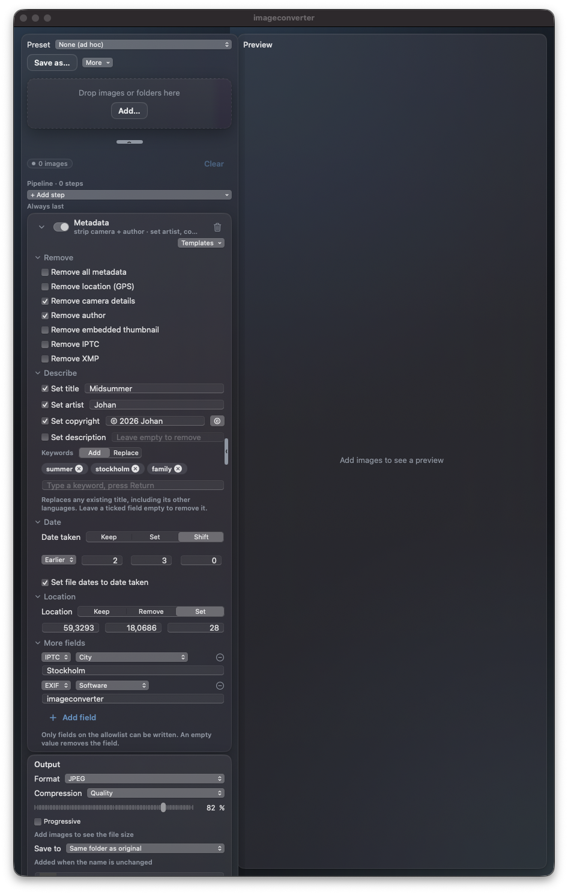

# imageconverter

A native macOS app for **batch image processing**. Drop in a pile of images or folders, build a
pipeline once (resize, crop, watermark, clean metadata, rename, convert) and run it over all of
them. It reads every image format your Mac can decode and writes the common ones. Everything happens
on your Mac: no uploads, no network access at all.

For anyone who regularly prepares photos for the web, for sharing or for archiving, and is tired
of doing it one image or one operation at a time.

**Version:** 0.1.0 · **Status:** early development (milestone 1, batch conversion, works; the image steps resize, crop, rotate/flip, canvas and color profile, plus metadata and rename, are available; the adjust and watermark steps are available; presets and the before/after preview are available).
Started 2026-11-13. The full design is in
[docs/superpowers/specs/2026-11-13-imageconverter-design.md](docs/superpowers/specs/2026-11-13-imageconverter-design.md).

## What's new

### Unreleased

- Watermark editor: rotation (with 0°/−45°/45°/90° buttons), a Tiled layout (spacing, staggered rows), shadow and outline for text, an **Insert** menu for tokens such as `{filename}` and `{year}` with the text shown for the selected image, SVG logos (including Illustrator exports), and a **Templates** menu (Apply, Save as template…, Delete).
- If / then / else steps: test each image's size, file size, format, transparency, orientation, GPS or camera, and give it its own steps, output, metadata or rename, copy it unchanged or skip it; the preview shows which branch an image takes, and skipped files are counted apart from failures.
- Geometry editors: free angle and straighten, Perspective (Auto and keystone), Trim and the canvas Ratio mode.
- Compression modes in the Output row: Quality, Target size, Maximum size and Smart, Progressive JPEG, Optimise PNG and AVIF; the estimate shows the chosen quality.
- Compression report: size percentages in the estimate and preview, a "saved" toast after a run, and a Report section in the sidebar (per-file sizes, skipped files, notes).
- **Save to** dropdown in the Output row (new folder, same folder, overwrite originals) replaces the Settings window; the Rename step is unavailable while overwriting, and the same-folder suffix defaults to `_new`.
- Adjust step: exposure, brilliance, highlights, shadows, contrast, brightness, black point, saturation, vibrance, warmth, tint, hue, sharpness, definition and noise reduction.
- Find and replace (plain text or regular expression) in the Rename step.
- Size estimate ("Original → about") under the quality slider.
- Grab handles on the panel edges and View > Hide Preview (⌥⌘P) / Collapse Pipeline (⌥⌘L); the window resizes with them.
- Original | Result table under the preview (name, folder, dimensions, size); progress bar and Cancel above it during a run.
- Pipeline rows reorder with a drag handle (Move Up/Down in the context menu).
- Zoom the before/after preview with a trackpad pinch (or ⌘+ / ⌘− / ⌘0); both sides stay in sync, so encoder artifacts are easy to compare.
- Presets (save, save as, rename, delete, reset; three built-ins) and a collapsible before/after preview with a filmstrip of the batch.
- Watermark step: text (font, colour, shadow, outline, tokens such as `{filename}` or `{year}` filled in per image) or an image (e.g. a PNG or SVG logo, optional shadow), placed once at one of nine positions or tiled over the whole image, with size relative to the image, opacity, margin, rotation and reusable templates.
- Metadata step (remove location, camera details or everything; set artist, copyright and description) and Rename step with tokens ({date}, {camera}, {counter:000}, …) and a live example.
- Wide-colour (Display P3) photos keep their colour when resized and saved as JPEG; opaque images stay opaque through steps; memory use accounts for enlargement.
- Pipeline steps: resize, crop, rotate/flip, canvas/padding and color profile; steps can be reordered, switched off and removed; the pipeline is kept between launches. Large images are scheduled by memory use; file types macOS can't read (e.g. SVG) are ignored when adding folders.

### 0.1.0

- Project created. Older versions are listed in [CHANGELOG.md](CHANGELOG.md).

## Features

- **Reads** every format macOS can decode: HEIC, JPEG, PNG, TIFF, GIF, BMP, WebP, AVIF, PSD, camera
  RAW, JPEG 2000, ICNS and more. Animated and multi-page files are read using their first frame.
- **Writes** JPEG, PNG, HEIC and TIFF, plus GIF, BMP and JPEG 2000 where macOS supports them, with
  quality and compression options.
- **Pipeline** of steps, applied in order to every image. Steps can be switched off and reordered:
  - (available) **Resize**: a grouped mode picker. *Pixels*: max width, max height, fit inside a box,
    exact size (stretch, fit and pad, or fill and crop), longest edge, shortest edge, minimum size.
    *Scale*: percentage (1 to 1000). *Print*: physical size in cm or inches at a DPI (leave one side empty
    to follow the aspect ratio; with both set the image fits inside). Every mode keeps the aspect ratio
    except Stretch. "Don't enlarge" is on by default and is hidden for the modes where it makes no sense
    (percentage, physical size, minimum size, stretch). A **Presets** menu fills the editor: Social media
    sizes (exact size, fill and crop, enlarging) and Resolutions such as 1080p and 4K (fit inside, don't
    enlarge). Pick the **resampling** (Lanczos, Bicubic, Bilinear, Nearest neighbour). **Set DPI** (default
    300) labels the output's print resolution without changing pixels.
  - (available) **Crop**: fixed size or aspect ratio (a menu of common ratios or a custom one), with an anchor point
  - (available) **Rotate / flip**: 90° turns, an **Angle** (slider −45…45°, or type −180…180°, clockwise) with
    **Fill corners** (white, transparent or a colour; the canvas grows) or **Crop to fit (straighten)** (the
    largest centred rectangle with the original ratio), **Mirror (flip horizontally)** and **Flip vertically**
  - (available) **Perspective**: **Auto** finds a document or screen and squares it up (the report says "No
    document edges found" if there is none); **Vertical** and **Horizontal** keystone sliders (−100…100) are
    applied after it, with the result cropped so no empty corners show
  - (available) **Trim**: removes a border of transparent pixels, one **Colour**, or the **Edge colour**
    (the colour of the top-left pixel); **Tolerance** 0–100 % and **Padding** in pixels keep a margin
  - (available) **Canvas / padding**: padding in pixels or percent, a fixed canvas size, or a **Ratio** (1:1 … 3:4 or
    custom) that grows the shorter side without cropping, with an anchor and a background colour
  - (available) **Color profile**: convert to sRGB, Display P3 or Gray, or keep the original
  - (available) **Adjust**: exposure, brilliance, highlights, shadows, contrast, brightness, black point,
    saturation, vibrance, warmth, tint, hue, sharpness, definition and noise reduction
  - (available) **Watermark**: text (with tokens, shadow and outline) or image (raster or SVG), single or tiled,
    with position, size, opacity, margin and rotation controls, and watermark templates
  - (available) **Condition** (if / then / else): up to 10 tests,
    all or any of which must hold: longest edge, width, height or file size (greater than, less than, at
    least, at most), format (a writable format or any file type, e.g. camera RAW), transparency (a
    transparent pixel, checked on a small thumbnail), portrait / landscape / square, has a GPS location,
    and camera make or model contains a text. Each branch can add image steps (not another condition),
    change the output format and settings, metadata or rename for that image, **copy the original**
    unchanged (same bytes and extension, nothing decoded; in overwrite mode the file is left as it is) or
    **skip** it (nothing written; reported as "Skipped by a condition", not as a failure, and not given a
    counter number). Conditions are tested against the **source file** (its header), not against the image
    part-way through the pipeline, so a resize before a condition doesn't change what it sees. With
    several conditions, later overrides win and skip wins over copy. The preview and size estimate follow
    each image's own branch.
  - (available) **Metadata** (always last, above Output): strip everything (with a keep list) or single
    groups, set title, artist, copyright, description, keywords, date taken, GPS and allowlisted extra fields,
    with templates; the color profile is always kept
  - (available) **Rename** (always last): a pattern such as `{date:yyyy-MM-dd}_{camera}_{counter:000}`,
    with a live example
- **Presets**: save a pipeline under a name (Save, Save as, rename, delete, reset to the saved version), start from three built-ins, or set up a one-off run without saving. A preset holds the steps, output format and quality, metadata and rename; the output mode stays a global setting.
- **Live preview** of the selected image before and after the pipeline, with its new name and
  size, an Original | Result table (name, folder, dimensions, file size with a live estimate), and a filmstrip of the batch (click a thumbnail or use ← →); pinch to zoom both sides in sync. Renders happen in the background 300 ms after an edit. The preview (⌥⌘P) and the pipeline can both be collapsed for a compact window; the choice is remembered.
- **Safe runs**: progress with cancel, unreadable files skipped and listed at the end, no
  half-written files, and name collisions resolved with `_2`, `_3`, …

## Screenshots

<!-- Once the UI exists, show the screenshots in a grid with a caption under each (claude-shots
     --write imageconverter refreshes the images), e.g.:
<table>
  <tr>
    <td><br>The main window with preview</td>
    <td><br>Compact mode during a run</td>
  </tr>
</table>
-->

## Installation

Requires macOS 14 (Sonoma) or later.

- **Download** (from 1.0): a signed and notarized `imageconverter.app`. Move it to Applications
  and open it.
- **From source:**

  ```sh
  swift run           # opens the app window (or: claude-update)
  swift build
  ```

## Configuration

The output settings are in the Output row of the sidebar (there is no Settings window). The pipeline itself (steps and output format) is edited in the sidebar and saved automatically (UserDefaults key `currentPipeline`); if it cannot be read at launch you start with an empty pipeline and the default output.

| Setting | Options | Default |
|---------|---------|---------|
| Save to | New folder · Same folder as original · Overwrite original files (the "Save to" dropdown in the Output row) | New folder |
| Output folder | Any folder (used by "New folder") | asked on first run |
| Same-folder suffix | Added by "Same folder" only when the output would have the same name as the original | `_new` |

Metadata and Rename (pipeline steps, saved with the pipeline; "Always last"):

| Option | What it does | Default |
|--------|--------------|---------|
| Metadata | Switches the Metadata step on | off |
| Remove all metadata | Strips all metadata except the **Keep** list (copyright, author, date taken, camera details, location; orientation and the color profile are always kept) | off |
| Remove location / camera / author / thumbnail / IPTC / XMP | Individual removals (see "Metadata step" below) | location on, others off |
| Set title / artist / copyright / description | Writes the text after the removal (an empty text removes the field; the © button inserts the sign) | off |
| Keywords | Tokens added to, or replacing, the file's keywords | none |
| Date taken | Keep, Set (date and time) or Shift (earlier/later by days, hours, minutes) | Keep |
| Set file dates to date taken | The output file's creation and modification dates follow the date taken | off |
| Location | Keep, Remove, or Set latitude, longitude and optional altitude | Keep |
| More fields | Extra EXIF/IPTC/XMP fields from the allowlist | none |
| Rename | Switches the Rename step on | off |
| Pattern | Rename pattern, see the token table below | `{name}` |
| Find / Replace | Replaces text in the name after the pattern; plain text or a regular expression | empty |
| Prefix / Suffix | Text added before and after the finished name (after find and replace) | empty |
| Remove spaces | Deletes all spaces from the name | off |
| Special characters | Keep, Replace (each run of other characters becomes one `-`, `_`, `.` or nothing; runs at the ends are trimmed) or Remove everything except letters (any language), digits, `-`, `_` and `.` | Keep |
| Case | Keep, lowercase, UPPERCASE, camelCase, PascalCase, snake_case, kebab-case or Title Case | Keep |
| Counter starts at | First `{counter}` value, 0 to 999 999 999 | 1 |

While the Metadata step is on, the file's XMP (Lightroom/Photoshop fields such as usage terms) is carried over
too, cleaned with the same rules: removing everything, the location, camera details, the author or IPTC also
removes those fields from the XMP. With the step off, only EXIF, IPTC and GPS are copied, as before.

Adjust (pipeline step, saved with the pipeline). Every slider defaults to 0 (no change); the step is applied in
this fixed order whatever order the sliders are moved in:

| Option | What it does | Range |
|--------|--------------|-------|
| Exposure | Brightens or darkens the whole image (±2 stops) | −100 to +100 |
| Highlights | Negative recovers bright areas, positive lifts them | −100 to +100 |
| Shadows | Positive opens up dark areas, negative deepens them | −100 to +100 |
| Brilliance | Positive lifts shadows and softens highlights, negative does the opposite | −100 to +100 |
| Black point | Positive deepens the blacks, negative lifts them to grey | −100 to +100 |
| Contrast | Lower or higher contrast | −100 to +100 |
| Brightness | Shifts all tones darker or lighter | −100 to +100 |
| Saturation | −100 is black and white, +100 doubles the colour | −100 to +100 |
| Vibrance | Like saturation, but mostly affects muted colours | −100 to +100 |
| Warmth | Positive is warmer (more yellow), negative cooler (more blue) | −100 to +100 |
| Tint | Positive is more magenta, negative more green | −100 to +100 |
| Hue | Rotates every colour around the colour wheel | −180° to +180° |
| Noise reduction | Smooths fine grain | 0 to 100 |
| Definition | Local contrast (a wide, gentle unsharp mask) | 0 to 100 |
| Sharpness | Sharpens fine detail | 0 to 100 |

Watermark (pipeline step, saved with the pipeline):

| Option | What it does | Default |
|--------|--------------|---------|
| Content | Text or Image | Text (a new step starts with `© ` and your full name) |
| Templates | Apply a built-in or saved watermark, save the current one as a template, delete a saved one | – |
| Text | The text to draw, on one line; may contain tokens (see below). Control and invisible characters are removed and it is cut to 200 characters | `©` |
| Insert | Adds a token at the end of the text; the line under the field shows the text for the selected image | – |
| Font | Helvetica Bold, Helvetica, Avenir Next Demi Bold, Georgia Bold, Menlo Bold or System bold | Helvetica-Bold |
| Color | Text colour (with transparency) | white |
| Shadow | Text or image: a drop shadow down and to the right, with colour, Blur (0 to 50 %) and Offset (0 to 50 %), both relative to the mark's height | off (when on: black at 60 %, blur 10 %, offset 6 %) |
| Outline | Text only: a stroke around the letters, under the fill, with colour and Width (0 to 20 % of the line height) | off (when on: black, 6 %) |
| Image | A logo or picture: any format the app reads (PNG, JPEG, HEIC, TIFF, …) or SVG (see below) | none |
| Layout | Single (one mark at the position) or Tiled (repeated over the whole image) | Single |
| Spacing | Tiled only: gap between marks, percent of the (rotated) mark's size (0 to 400 %) | 100 % |
| Stagger rows | Tiled only: every other row is shifted by half a step | on |
| Position | One of nine anchor points (not used when tiled) | bottom right |
| Size | Percent of the shorter side of the photo (1 to 100 %) | 4 % for text, 20 % for an image |
| Opacity | 0 to 100 % | 65 % |
| Margin | Distance from the edges, percent of the shorter side (0 to 25 %); not used when tiled | 3 % |
| Rotation | −180° to 180°, clockwise, about the mark's centre (buttons for 0°, −45°, 45° and 90°) | 0° |

Built-in watermark templates: **© corner** (`© {year} {artist}`, bottom right, 4 %), **Tiled diagonal**
(`© {artist}`, tiled at −30°, 15 % opacity) and **Filename + date** (`{filename} · {date}` with a shadow, bottom
left). Saved templates are JSON files in `~/Library/Application Support/imageconverter/watermark-templates/`;
an image template stores the image's path.

Watermark text tokens (unknown tokens are drawn as typed):

| Token | Becomes |
|-------|---------|
| `{filename}` | The original's name without its extension |
| `{filename.ext}` | The original's name with its extension |
| `{date}` | The date taken (from the photo's EXIF, else the file's creation date) as `2026-11-14` |
| `{date:FORMAT}` | The same date in your own format, e.g. `{date:d MMM yyyy}` (Unicode date patterns) |
| `{year}` | The year of that date |
| `{copyright}` | The copyright: from the Metadata step when it sets one, else the file's own; empty when the Metadata step removes it |
| `{artist}` | The author, the same way (empty when the Metadata step removes the author) |

SVG watermarks: an SVG logo is checked and rewritten before it is drawn, and nothing is ever downloaded.
It can be at most 1 MB and must be plain SVG in UTF-8: shapes, paths, gradients, clip paths, masks, patterns and
text, linked only to parts of the same file. The standard SVG doctype and simple style sheets (as Adobe Illustrator
exports them: rules like `.st0{fill:#E30613;}` for classes, ids or element names, setting colours, strokes, fonts
and opacity, including `rgb()` and `hsl()` colours) are accepted, up to 2 000 selectors. Style rules are applied in a
simplified way: a later rule wins over an earlier one whatever its selector, and a colour or other setting written
directly on a shape wins over the style sheet (browsers let the style sheet win), so a file that mixes both can look
different here. Anything else is refused with the reason, shown
under **Choose image…** and for each file in the batch:
- "This SVG uses embedded images or links to other files, which aren't allowed." (embedded pictures, `data:` URLs,
  links to other files or websites, `@import`)
- "This SVG uses features that aren't supported (scripts, animation or advanced styling)." (scripts, animation,
  entities, CSS beyond simple rules, references that loop or expand to more than 10 000 shapes)
- "This SVG is too large (over 1 MB)." and "This file isn't a valid SVG."

When an SVG is refused, export the logo again as plain SVG (or as a PNG with a transparent background).

Presets and preview:

| Setting | What it is | Default |
|---------|------------|---------|
| Presets folder | `~/Library/Application Support/imageconverter/presets/`, one `<UUID>.json` file per preset | created on first save |
| Web export (built-in) | Resize fit 2048 × 2048, color sRGB, metadata strip location, JPEG 82 % | n/a |
| Instagram 4:5 (built-in) | Resize exact 1080 × 1350 fill & crop, sRGB, metadata strip location, JPEG 85 % | n/a |
| Archive TIFF (built-in) | No image steps, metadata off, TIFF LZW | n/a |
| Show preview | View → Hide Preview / Show Preview (⌥⌘P); UserDefaults key `previewCollapsed` | shown |
| Pipeline collapsed | The handle on the pipeline's edge or View → Collapse Pipeline (⌥⌘L); key `pipelineCollapsed` | expanded |

In *Overwrite originals* mode, a rename that only changes letter case keeps the original name.

CMYK and indexed-colour sources are converted to sRGB by pixel steps (colour-managed, so they
look the same). Gray images stay gray (with or without transparency), and wide-colour (Display P3)
images keep their colour space.

Choosing **Overwrite originals** shows a warning once, when you select it, and never during runs.
In this mode, when the format or name changes (for example HEIC → JPEG), the new file is written
and the original is **moved to the Trash**. In "New folder" mode, dropped folders keep their
subfolder structure.

Planned for the signed 1.0 release: the app will be sandboxed, so it can only touch files and
folders you drop or pick. When you drop loose files and write next to them, it will ask once per
folder for access and remember your answer. Until then it runs unsandboxed.

## How to

### Save a preset

1. Build the pipeline, then press **⌘S** (or Save in the preset bar). On a built-in or a one-off
   pipeline this opens "Save as": type a name (1 to 80 characters, unique) and confirm.
2. Pick a preset in the preset bar to load it. If you have unsaved changes, you are asked
   "Discard changes to <name>?" first. Reset returns to the saved version; rename and delete are in
   the preset bar. Built-ins can't be changed or deleted.

### Preview before running

1. Add images; the preview pane on the right shows the first one before and after the pipeline,
   with an Original | Result table underneath (name, folder, `W × H`, file size; the result size is estimated and shows "Estimating…" while it is computed).
2. Click a thumbnail in the filmstrip, or focus it and press ← / →, to look at another image.
3. Edit a step: the preview updates 300 ms later, and shows a spinner meanwhile. If an image can't
   be rendered, the reason is shown instead of the "after" image. The preview shows the name for
   that image alone; numbers like `_2` that avoid clashes within a batch appear only when you run it.
4. Hide the preview with the handle on its edge or ⌥⌘P (View menu); the window shrinks to the sidebar. While a batch runs, the progress bar and Cancel sit above the table.
5. Zoom in to compare quality: pinch on either image (both zoom around the pinch point and always
   show the same region), pan with two fingers or by dragging, double-click to switch between fit and
   100 % (one image pixel per screen pixel) at that point. View › Zoom In (⌘+ or ⌘=), Zoom Out (⌘−),
   Zoom to Fit (⌘0) and Actual Size (⌥⌘0) do the same from the keyboard. Zoom goes up to 800 %; the
   level shows next to the "Preview" title. Once the size estimate is ready, the zoomed view shows the
   full-size original and the really encoded result (above 100 % without smoothing), so JPEG blocks
   and other artifacts are visible. Selecting another image resets to fit; changing settings keeps
   the zoomed region. Both sides show the same region when the pipeline has no Crop, Rotate / flip
   or Canvas step (resize and format changes are fine); with those steps the two sides are zoomed to
   the same relative position, which is not yet the same part of the photo.

### Build a pipeline

1. In the sidebar, press **+ Add step** and pick Resize, Crop, Rotate / flip, Perspective, Trim, Canvas / padding,
   Color profile, Adjust, Watermark or **If … then … else** (see below). The step is added at the end and opens so you can set it.
2. Open or close a step by clicking its row; its settings (size, anchor, colour, profile, ...) are
   inside. The muted line under the name summarises them. The header shows how many steps are on.
3. Reorder by dragging the handle, or with the keyboard: the right-click menu has
   **Move Up**, **Move Down** and **Remove**.
4. Switch a step off with its toggle to skip it without losing its settings; it is dimmed.
5. Steps run top to bottom on every image. The **Output** row is always last: format, quality and
   where files go. The handle on the pipeline's bottom edge (or ⌥⌘L) hides the whole list.

Your pipeline is kept between launches.

### Convert a batch

1. Drop images or folders onto the window, or press **Add…** (⌘O). Folders are searched
   recursively. File types macOS can't read (for example SVG or PDF) are ignored when you add
   them; broken files of a readable type are skipped during the run and listed at the end.
2. Under **Output** (the last row of the pipeline), pick a format (JPEG, PNG, HEIC, TIFF, plus GIF, BMP, JPEG 2000 and AVIF where your
   Mac can write them). JPEG, HEIC, JPEG 2000 and AVIF have a **Compression** choice: *Quality* (the slider, 0–100 %),
   *Target size* (the highest quality that fits a size you type, in KB or MB, 1 KB = 1000 bytes), *Maximum size* (the slider's quality, lowered
   only as far as needed; files that can't fit are skipped) or *Smart* (the lowest quality that still looks the same, up to 95 %). JPEG has a
   *Progressive* toggle, PNG an *Optimise PNG* toggle (smaller, slower), TIFF a compression choice.
3. Below the controls, the size estimate shows "Original → about" for the selected image, with the chosen quality ("at 74 %") when a size
   or Smart mode searched for one, or why a maximum size can't be met. Use **Save to** to pick *Overwrite original
   files* (originals that are renamed or change format go to the Trash; Rename is unavailable), *Same folder as original* (the suffix, default `_new`, is added only if the output would have the same name as the original; or the Rename pattern applies) or *New folder*.
4. Press **Run on N images** (⌘R). In *New folder* mode with no folder chosen yet, you are asked to
   pick one first. Cancel with ⌘. at any time; files already finished stay, and no half-written
   files are left.
5. When it ends, a notice shows the result. Files that could not be converted are listed in the
   sidebar (name and reason) until the next run.

### Metadata step

The Metadata editor has five collapsible groups and a **Templates** menu:



- **Remove**: all metadata (with a **Keep** checklist: copyright, author, date taken, camera details,
  location; orientation is always applied to the pixels and the color profile is never stripped, so those two
  are shown ticked and locked), or individually location (GPS), camera details, author, the embedded thumbnail,
  IPTC and XMP.
- **Describe**: title, artist, copyright, description and keywords. Keywords are tokens (Return or a comma
  adds one); **Add** merges them with the file's own, **Replace** replaces them (empty Replace clears them).
- **Date**: keep the date taken, **Set** it, or **Shift** it earlier or later by days, hours and minutes
  (files without a date keep none). **Set file dates to date taken** also changes the file's own dates.
- **Location**: keep, remove, or set latitude (-90 to 90), longitude (-180 to 180) and an optional altitude in
  metres; wrong values show a message and nothing is written until they are fixed.
- **More fields**: rows of namespace (EXIF, IPTC, XMP), field and value. Only fields on a fixed **allowlist**
  can be chosen (EXIF: ImageDescription, Artist, Copyright, Software, Make, Model, LensModel, UserComment,
  BodySerialNumber; IPTC: ObjectName, Headline, Byline, BylineTitle, Credit, Source, CopyrightNotice,
  CaptionAbstract, City, SubLocation, ProvinceState, CountryName, CountryCode, Writer, SpecialInstructions,
  OriginalTransmissionReference; XMP: dc, photoshop, xmpRights and Iptc4xmpCore fields). Anything else in a
  saved pipeline or template is dropped when it loads. An empty value clears the field.
- **Templates**: *Apply* adds a template's settings on top of the current ones (removals only ever turn on,
  fields it sets replace yours, custom fields merge), *Save as template...* stores the current settings under a
  name, *Delete* removes a saved one. Three built-ins: Privacy, Web (keep copyright) and Remove everything.
  Templates are files in `~/Library/Application Support/imageconverter/metadata-templates/`.

Limits of ImageIO: the XMP packet can only be left out completely for JPEG and TIFF; PNG, HEIC and GIF keep
EXIF and IPTC inside XMP, so "Remove XMP" removes only the XMP-only fields there. Setting a title replaces
all of the file's language variants of it (only the one you typed remains).

### Strip location before sharing

1. In the pipeline, under **Always last**, open **Metadata** and switch it on.
2. In **Remove**, leave **Remove location (GPS)** on. Add **Remove camera details** to drop the make, model, lens
   and serial numbers too, or **Remove all metadata** to strip everything.
3. Optionally open **Describe** and tick **Set artist**, **Set copyright** or **Set description** and type the text; it is
   written after the removal, so it survives. Untick to leave a field as it is. A ticked field with empty text removes that field.
4. Run the batch. The removed information is not in the output files. The color profile is always
   kept, so the images look the same.

### Rename by date and camera

1. Open **Rename** (under **Always last**) and switch it on.
2. Type a pattern, for example `{date:yyyy-MM-dd}_{camera}_{counter:000}`, or build it with
   **Insert**, which appends at the end.
3. The line under the pattern shows an example from the first image in the batch (or a sample
   photo when the batch is empty), such as `Example: 2026-11-13_iPhone 15 Pro_001.jpg`. An
   unknown token like `{foo}` is flagged with a warning and kept as written (`:` still becomes `-`).
4. Set **Counter starts at** if numbering should not begin at 1. The counter follows input order.
5. In *Same folder* mode the pattern replaces the suffix (the summary says "Same folder,
   renamed"). Names that come out identical get `_2`, `_3`, …
6. **Insert** also holds three quick patterns that replace the whole pattern: *Date + counter*
   (`{date:yyyy-MM-dd}_{counter:000}`), *Camera + date* (`{camera}_{datetime}`) and *Name + size*
   (`{name}_{width}x{height}`).
7. Optionally fill **Find** and **Replace** to change text in the resulting name; tick the regular
   expression option for patterns. The Rename step is greyed out while *Overwrite original files* is selected.
8. Use **Prefix**, **Suffix**, **Remove spaces**, **Special characters** and **Case** to tidy the result.
   Order: pattern, find and replace, prefix and suffix, spaces, special characters, case. The example line
   shows the effect of every option.

Rename tokens:

| Token | Meaning | Example |
|-------|---------|---------|
| `{name}` | Original file name without extension | `IMG_0001` |
| `{ext}` | Output file extension | `jpg` |
| `{date}` / `{date:<format>}` | Capture date (EXIF, else file creation date); default `yyyy-MM-dd` | `2026-11-13`, `{date:yyyyMMdd}` gives `20261113` |
| `{time}` / `{time:<format>}` | Capture time; default `HHmmss` | `140509`, `{time:HH-mm}` gives `14-05` |
| `{camera}` | Camera model | `iPhone 15 Pro` |
| `{make}` | Camera maker | `Apple` |
| `{lens}` | Lens model | `iPhone 15 Pro back camera 6.765mm f/1.78` |
| `{iso}` | ISO speed | `80` |
| `{width}` / `{height}` | Pixel size of the output, after the image steps | `1600` / `1200` |
| `{format}` | Output format | `JPEG` |
| `{folder}` | Name of the source folder | `Holiday` |
| `{counter}` / `{counter:000}` | Running number; the zeros set the padding | `1`, `{counter:000}` gives `001` |
| `{seq}` | Same as `{counter}` (a sequence number) | `1` |
| `{focal}` | Focal length | `24mm` |
| `{aperture}` | Aperture | `f1.8` |
| `{shutter}` | Shutter speed | `1-250s` |
| `{datetime}` | Capture date and time | `2026-11-13_140509` |

Metadata is untrusted, so names are sanitised: `/` and `:` become `-`; control, bidi and invisible
(zero-width) characters are removed; an empty token drops one neighbouring separator (`_`, `-` or
space); leading dots and separators at the ends are trimmed; names are capped at 200 characters
and 240 bytes; and an empty result falls back to the original name (or `image`).

### Adjust tone and colour

1. Press **+ Add step** and pick **Adjust**, then open the step.
2. Move the sliders in **Light**, **Colour** and **Detail**; the preview updates as you go.
3. Double-click a slider's label to set it back to 0, or press a group's **Reset** to clear the whole group.
4. Put the step after resizing if you want sharpening to suit the final size. The step keeps each
   image's RGB colour space (sRGB, Display P3, …), bit depth and transparency. Gray, CMYK and indexed
   images come out of the step in sRGB (Core Image works in RGB); add a Color profile step set to Gray
   after it to get a gray file back.

### Add a watermark

1. Press **+ Add step** and pick **Watermark**. A new step is text and starts with `© ` and your full name.
2. Choose **Text** (edit the text, font and colour) or **Image** (**Choose image…**, for example a
   logo with a transparent background or an SVG; **Remove** clears it). Switching back and forth keeps what you
   entered. For text, **Insert** adds tokens such as `{filename}` or `{year}`; the line under the field shows the
   text as it will be drawn on the selected image. Turn on **Shadow** or **Outline** to keep light text readable
   on light photos.
3. Pick a **Position** in the 3 x 3 grid, or choose **Layout › Tiled** to repeat the mark over the whole image
   (set **Spacing** and **Stagger rows**; position and margin are then not used). **Rotation** turns the mark,
   for example −30° for a diagonal tiled watermark.
4. Set **Size**: it is a percentage of the photo's *shorter* side, so the mark looks the same on
   landscape and portrait photos. For an image it is the watermark's width; for text it is the height of a line of text.
   Defaults are 4 % for text and 20 % for an image (switching content switches the size too, unless you changed it).
5. Set **Opacity** and **Margin** (distance from the edges, also a percentage of the shorter side).
   The mark is always scaled down to fit inside the photo with twice the margin removed, so it is never cut off.
6. Put the step after resizing and cropping if the mark should be sized to the final image. If an
   image watermark can't be read when the batch runs, those files are skipped and listed.
7. To reuse a watermark, choose **Templates › Save as template…** and give it a name; **Templates › Apply** puts
   it (or a built-in) into the step, and **Templates › Delete** removes a saved one.

### Process images differently by size, format or orientation

1. Press **+ Add step** and pick **If … then … else** (at the bottom of the menu). The step tests each image's *source
   file* (not the image part-way through the pipeline) and runs the **Then** actions when it matches, the **Else**
   actions when it doesn't. Its actions take the step's place in the pipeline.
2. Under **Match all / any of:**, set up to 10 conditions: **Longest edge**, **Width**, **Height** (>, <, ≥, ≤ a number
   of pixels), **File size** (in KB or MB, 1 KB = 1000 bytes), **Format** (the writable formats, plus RAW from any camera,
   WebP and any HEIF), **Transparency** (has transparency / is opaque), **Orientation** (portrait, landscape, square),
   **Location** (has GPS / has no GPS) and **Camera** (make or model contains a text). **+ Add condition** adds one;
   the trash button removes one (a step always keeps at least one).
3. Fill **Then** and **Else** with **+ Add**: any image step (Resize, Crop, Watermark, …), **Set output…** (format and
   compression for these images), **Set metadata…**, **Set rename…**, **Copy original unchanged** (the file is copied as
   it is, nothing is decoded) or **Skip file** (nothing is written; the file counts as *skipped by a condition*, not
   failed, and takes no counter number). Open an action to edit it with the usual editor; reorder actions by
   dragging the handle or with **Move Up** / **Move Down** in the right-click menu.
4. Select an image in the filmstrip: the preview header shows which branch it takes (**Then branch** / **Else branch**,
   or "1 then · 2 else" with several conditions) and whether it is **Copied unchanged** or **Skipped by a condition**.
   The Result name and the Rename example use the number the batch would give it.
5. After a run the notice says, for example, "Converted 20 · 3 skipped by conditions · 1 failed"; the Report lists the
   skipped files separately from failures.

Examples (one step each):

| If | Then | Else |
| --- | --- | --- |
| Longest edge > 4000 px | Resize › Longest edge 2048 | (nothing) |
| Format is PNG **and** has transparency | Set output… › PNG | Set output… › JPEG |
| Format is JPEG | Set output… › HEIC (WebP can't be written by macOS) | (nothing) |
| Location: has GPS | Set metadata… › Remove location (GPS) | (nothing) |
| File size < 500 KB | Copy original unchanged | (nothing) |
| Orientation: portrait | Resize › Longest edge 1080 | Resize › Longest edge 2048 |
| Orientation: landscape | Set output… › HEIC at 70 % | Set output… › JPEG at 85 % |

(More how-tos once the features exist: build and save a preset.)

## Tests

```sh
swift test
swiftlint           # if installed (brew install swiftlint)
```

## License

MIT. See [LICENSE](LICENSE).
